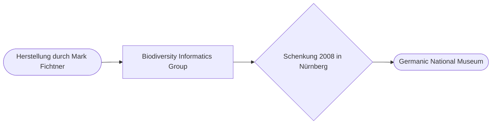

# Diagramme mit draw.io

draw.io ist in das SCS Drive eingebaut. Du öffnest es nicht für sich: Du legst Diagramme an und öffnest sie wie jede andere Datei im Drive.

## Ein Diagramm anlegen

1. Öffne das Drive von der Projektseite aus: **Dateien → Go to file system**.
2. Wähle im Team-Ordner **+ Neu → Neues Diagramm**.
3. Gib einen Namen ein, zum Beispiel `Provenienz Wanderkrug.drawio`, und wähle **Erstellen**.

Die Datei öffnet sich im draw.io-Editor. Später öffnet ein Klick auf eine `.drawio`-Datei sie wieder.

## Ein einfaches Flussdiagramm zeichnen

Zeichne als Beispiel die Provenienz des Demo-Objekts *Antique WissKI Ceramic Travelling Jug with Network Motifs*, so wie sie in der Demo-WissKI erfasst ist:

1. Öffne links die Formenbibliothek **Allgemein** oder **Flussdiagramm**.
2. Zieh eine abgerundete Form als Start auf die Seite: *Herstellung durch Mark Fichtner*. Ein Doppelklick auf die Form öffnet die Texteingabe.
3. Füge ein Rechteck *Biodiversity Informatics Group*, eine Raute *Schenkung 2008 in Nürnberg* und eine abgerundete Form *Germanic National Museum* hinzu.
4. Verbinde sie: Fahr mit der Maus über eine Form und zieh einen der blauen Pfeile auf die nächste Form. Der Pfeil haftet an beiden Formen und wandert mit, wenn du sie verschiebst.
5. Ist eine Form ausgewählt, änderst du im Bereich rechts Farbe, Linie und Text.

Speichere mit **Strg+S** oder **Datei → Speichern**. Der Beenden-Knopf oben rechts schließt draw.io und bringt dich zurück in den Ordner.

## Gemeinsam arbeiten

Das Diagramm liegt im Team-Ordner, also kann jedes Projektmitglied es öffnen. Haben mehrere Personen es gleichzeitig offen, zeigt draw.io die Änderungen der anderen und führt sie beim Speichern zusammen. Speichere oft, damit die anderen deine Änderungen sehen.

Hinterlasse Notizen im Diagramm selbst, zum Beispiel eine Textform *noch prüfen*, oder kommentiere die Datei im Drive unter **Details**.

## Ein Diagramm teilen

Eine `.drawio`-Datei teilst du wie jede andere Datei, siehe [Eine Datei oder einen Ordner freigeben](drive.md#eine-datei-oder-einen-ordner-freigeben).

Für Personen ohne SCS-Konto exportierst du das Diagramm: **Datei → Exportieren als → PNG**, **SVG** oder **PDF**. Der Export landet im selben Ordner und lässt sich per Link teilen.
