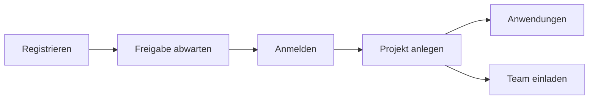

# Benutzerhandbuch

Wie du die SCS-Plattform im Alltag nutzt. Deployment und Server-Interna stehen in der [Technischen Dokumentation](../technical/index.md).

Die Bilder zeigen das Demo-Projekt **robert Demo**. Ein Demo-Projekt bringt WissKI, JupyterHub und WebProtégé mit Beispieldaten mit. Jedes freigegebene Konto bekommt genau eines, zusätzlich zum eigenen Projekt.

## Anleitungen

1. [Registrierung](registrierung.md) — Konto beantragen und auf die Freigabe warten.
2. [Anmeldung](anmeldung.md) — mit dem SCS-Login auf die Projektseite kommen.
3. [Projekt anlegen](projekt-anlegen.md) — eigenes Projekt. Das Demo-Projekt ist schon da.
4. [Anwendungen](anwendungen.md) — WissKI, JupyterHub, WebProtégé, SQL-Datenbank und Triplestore.
5. [Projektmitglieder](mitglieder.md) — Personen einladen, annehmen, entfernen.
6. [Projektdateien](projektdateien.md) — der gemeinsame Ordner in Drive, JupyterHub und WissKI.

## Verfügbare Anwendungen

- [JupyterHub mit OpenRefine](apps/jupyter.md)
- [MariaDB mit phpMyAdmin](apps/mariadb.md)
- [Nextcloud mit OnlyOffice und draw.io](apps/nextcloud.md)
- [OpenGDB](apps/opengdb.md)
- [WebProtégé](apps/webprotege.md)
- [WissKI-Umgebung](apps/wisski.md)

## Hilfe benötigt?

Bei Fragen zu Zugriff, Freigaben oder Speicherplatz wende dich an deine Systemadministration.
