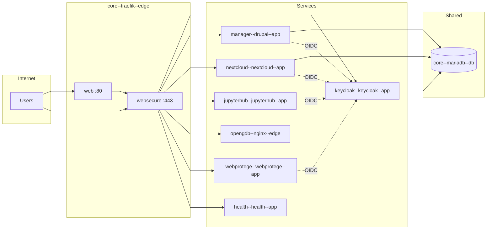

# Service infrastructure

This section describes what is in the SODa SCS Manager deployment and how the services are wired.

- **[Infrastructure inventory](inventory.md)** — every Compose environment, container, and host unit (what / effect / where configured).
- **[Scripts catalogue](scripts.md)** — `01_scripts/` and systemd timers.
- **[Custom configs](custom-configs.md)** — `00_custom_configs/` overlays and templates.
- **[Architecture overview](architecture-overview.md)** — C4-style Mermaid map.
- **[Naming vocabulary](naming-vocabulary.md)** / **[Naming migration plan](naming-migration-plan.md)**.
- **[Glossary](../glossary.md)** — sidecar, private files, Sail, LMDB, …

## Overview

The deployment is built from multiple Docker Compose files merged via the `COMPOSE_FILE` environment variable (see `example-env`). It includes:

- A **main stack** (`docker-compose.yml`): Traefik reverse proxy, shared MariaDB, Portainer, phpMyAdmin, and the **Nextcloud FUSE mounter** sidecar (`nextcloud-mounter`).
- **Submodule stacks**: SCS Manager (Drupal), Nextcloud, JupyterHub, Keycloak, OpenGDB, WebProtégé, the project website stack, and the SCS Health dashboard.

All services that serve HTTP or need to be reached by Traefik attach to the same Docker network, `reverse-proxy`. The shared MariaDB instance is used by Keycloak, SCS Manager, Nextcloud, and the project website; each has its own database and user created by pre-install scripts.

Keycloak is the central identity provider (IdP): SCS Manager, Nextcloud, JupyterHub, WebProtégé, and optionally OpenGDB AuthProxy use OpenID Connect to authenticate users against Keycloak.

## Architecture diagram



## Main stack (`docker-compose.yml`)

- **core--traefik--edge** (alias `scs--reverse-proxy`) — Traefik: HTTP/HTTPS entrypoints, TLS (e.g. Let’s Encrypt), middlewares (HTTPS redirect, Nextcloud headers, rate limiting). Routes by `Host(...)` using Docker labels. The Docker **network** remains `reverse-proxy`.
- **core--mariadb--db** (alias `scs--database`) — MariaDB. Single instance; databases and users for Keycloak, SCS Manager, Nextcloud, and project website are created by pre-install scripts.
- **core--portainer--app** (alias `scs--portainer`) — Portainer CE for container management; used by SCS Manager for WissKI stack operations.
- **dbms--phpmyadmin--app** (alias `scs--phpmyadmin`) — phpMyAdmin for database access (optional).
- **dbms--forwardauth--proxy** (alias `scs--forward-auth`) — Keycloak forward-auth for phpMyAdmin SSO.
- **nextcloud-mounter** — rclone `rcd` sidecar for per-user Nextcloud WebDAV/FUSE mounts. See [Nextcloud mount sidecar](nextcloud-mount-sidecar.md).

## Compose file aggregation

The `COMPOSE_FILE` in `example-env` lists, in order:

- Main: `docker-compose.yml`
- Stacks: `scs-manager-stack/docker-compose.yml`, `scs-nextcloud-stack/docker-compose.yml`, `jupyterhub/docker-compose.yml`, `keycloak/docker-compose.yml`, `open_gdb/docker-compose.yml`, `webprotege/docker-compose.yml`, `scs-project-website-stack/docker-compose.yml`, `scs-health/docker-compose.yml`
- Overrides: the corresponding `docker-compose.override.yml` files for each stack.

Override files are copied from `00_custom_configs/<stack>/docker/` to each stack directory by `start.sh` (see [Pre-start steps](../initial-setup/pre-start-steps.md)).

## Stacks and wiring

### Traefik

- Listens on ports 80 (HTTP) and 443 (HTTPS).
- Uses Let’s Encrypt for TLS (certificate resolver `le`).
- Middlewares: `rate-limit`, `rate-limit-high`, `rate-limit-strict`, and redirects (e.g. SCS Manager second domain).
- Drupal-facing services (SCS Manager, WissKI instances via Portainer, project website) use `rate-limit-high@docker` on external routers with an internal bypass router for Docker CIDRs. See [WissKI stack — bot protection](wisski-stack/index.md#bot-and-scanner-protection).
- Each service that should be reachable gets Traefik labels for router rule, entrypoints, TLS, and service port.

### Database

- **core--mariadb--db** (MariaDB, alias `scs--database`) is started first by `start.sh`. Pre-install scripts create:
  - Keycloak DB and user
  - SCS Manager DB and user
  - Nextcloud DB and user
  - Project website DB and user

### Keycloak

- Realm is generated from `00_custom_configs/keycloak/templates/realm/scs-realm.json.tpl` (pre-install) and imported at startup.
- Clients: JupyterHub (by `JUPYTERHUB_DOMAIN`), Nextcloud (by `NEXTCLOUD_NEXTCLOUD_DOMAIN`), SCS Manager (by `SCS_MANAGER_DOMAIN`), phpMyAdmin/DBMS (by `SCS_DBMS_DOMAIN`), WebProtégé, DIDMOS. Each has a client secret from `.env`.
- Uses the shared MariaDB for persistence.
- Exposed via Traefik on the Keycloak domain (e.g. `auth.scs.localhost`).

### SCS Manager

- Drupal application (and optionally Varnish in front). Image and mode from env (e.g. `scs-manager-image-development:latest`).
- **Host tree:** custom clones live only under `scs-manager-stack/volumes/drupal-root/` (`web/themes/custom/scs_custom_theme`, `web/modules/custom/soda_scs_manager`). The development compose file bind-mounts those checkouts into the container. Production does not: Prime runs the module and the theme from the production image. A pull of the host clone does not change Prime. The routine is [Ship changes from dev to Prime](../maintenance/dev-to-prime.md). The old full docroot `volumes/drupal` is retired; the leftover copy is at `/srv/backups/scs-manager/volumes-drupal-retired-20261107`.
- **Front theme:** [scs_custom_theme](https://github.com/soda-collections-objects-data-literacy/scs_custom_theme) is the default theme. The admin theme stays Gin. The manager UI styles ship with the module (`css/soda-scs-manager.css`, built from its `pcss/`); `scs_custom_theme` provides the page frame, base reset, Noto Sans and the cookie banner. The old `soda_scs_manager_theme` is retired (module update 11039 uninstalls it). On dev, `docker-compose.development.yml` bind-mounts the host clone, so a cache rebuild is enough after a local edit. Prime picks the theme up from the next image.
- The theme's `config/install` content types are not imported. Upstream config does not install on Drupal 11: `field_information_stairs_headline` is longer than 32 characters, and several view displays omit formatter `settings`. Enabling the theme with that directory in place aborts install and can leave partial field storage behind. Move `config/install` aside, run `drush theme:install scs_custom_theme -y`, then `drush config:set system.theme default scs_custom_theme -y`. Place blocks into the theme regions (`sidebar_logo`, `header_logo`, `header_nav`, `sidebar_secondary_nav`, `sidebar_account_menu`, `breadcrumb_and_title`, `edit_menu`, `content`, `footer_navs`, `header_user_menu`); blocks copied from the previous theme land in `header_logo` when those old regions do not exist.
- **Dashboard branding:** `logo.svg` in the theme root is the site logo. It ships with `scs_custom_theme` and reaches Prime in the next image. On dev the theme checkout is bind-mounted, so the file is visible without a rebuild. Branding blocks in `sidebar_logo` and `header_logo` keep the logo and hide the site name (`use_site_name: 0`). The region `sidebar_secondary_nav` renders the menu `sidebar-secondary-nav` (Administration, Dokumentation, Notifications). Do not also place the main menu or the custom book block in that region. After a module update, import the shipped German strings and rebuild caches:

```bash
docker compose exec -u www-data manager--drupal--app ./vendor/bin/drush locale:import de /opt/drupal/web/modules/contrib/soda_scs_manager/translations/soda_scs_manager.de.po --type=customized --override=all -y
docker compose exec -u www-data manager--drupal--app ./vendor/bin/drush cr
```

The `.po` path must be absolute. Drush resolves a relative path from the Drupal web root (`web/`), so `web/modules/...` is not found. The import marks strings as customized, including the toolbar label People → Personen.
- **Front page:** the page-title block stays in `content` but is hidden on `<front>`, so the node title "Home" does not sit above the hero. The main menu keeps Dashboard and Dokumentation. The module links Startseite, Administration, Nachrichten, and the duplicate Dokumentation link stay disabled; Administration and Notifications for signed-in users live in `sidebar-secondary-nav`. The public footer region `footer_navs` renders only the `footer-left` menu (Impressum, Datenschutzerklärungen, Nutzungsbedingungen, Barrierefreiheitserklärung), once each. The older duplicate links stay disabled. The blocks for the `footer` menu (issue report), Related, and Social stay disabled; those links are not part of the current front theme. Both language aliases `/de/home` and `/en/home` must point at the `home_page` node. The older `page` node "Welcome to your Semantic Co-Working Space" is not the front page; its alias is `/legacy-welcome`. The `home_page` bundle itself is not translatable. English text comes from the translated paragraphs it references (`home_hero_header`, `information_stairs`, `aspect_preview`, `cta_try`).
- OpenID Connect client config is generated from `00_custom_configs/scs-manager-stack/openid/openid_connect.client.scs_sso.yml.tpl` into `scs-manager-stack/custom_configs/openid_connect.client.scs_sso.yml` during pre-install. Drupal uses this for Keycloak SSO.
- Drupal settings (e.g. OpenID behaviour, reverse proxy) come from `00_custom_configs/scs-manager-stack/drupal/` (e.g. `openid-connect.settings.php`, `reverse-proxy.settings.php`).
- **Nginx / clean URLs:** `scs-manager-stack/configs/nginx/drupal.conf` is mounted into `scs-manager--drupal` so Drupal generates paths without `/index.php`. See [SCS Manager clean URLs](../troubleshooting/scs-manager-clean-urls.md) if links still show `index.php`.
- **PHP / OPcache:** Production must not mount `scs-manager-stack/configs/php/zz-xdebug-debug.ini` (that overlay disables OPcache and enables Xdebug). For local debugging, add the volume mount back in a dev-only compose override; see [PHP debugging (Xdebug)](php-xdebug.md).
- **User lifecycle (create/delete):** [SCS Manager user create and delete routines](scs-manager-user-lifecycle.md) — Keycloak registration, OIDC linking, Nextcloud credential attributes, and `hook_user_delete` cleanup.
- **Nextcloud mounts:** On `nextcloud-mounter-net`; owns mount lifecycle via `NextcloudMountManager` / Drush `scs:nextcloud-*`. See [Nextcloud mount sidecar](nextcloud-mount-sidecar.md).
- WissKI stacks are deployed via Portainer from `wisski-base-stack`. **Drupal reverse proxy addresses** in SCS Manager settings (`auto` by default) become `DRUPAL_PROXY_ADDRESSES` on the stack; the wisski-base-image syncs trusted proxy CIDRs into each instance `settings.php` on boot.
- Varnish VCL is generated from `00_custom_configs/scs-manager-stack/varnish/default.vcl.tpl` during pre-install.
- Connects to shared MariaDB (own database).
- **Modules required by active config:** `core.extension` enables `antibot`, `simple_menu_permissions`, and `token_filter`. If those packages are missing from the image, `drush updatedb` stops and `full_html` returns HTTP 500 (`token_filter` plugin missing). Install them in the container with `composer require drupal/antibot drupal/simple_menu_permissions drupal/token_filter`, then `drush cr`. That writes into the container layer; a recreate from an image that does not list the packages drops them again. `filter.format.full_html` keeps the `token_filter` filter enabled.

### Nextcloud

- Nextcloud FPM, reverse proxy (nginx), Redis, OnlyOffice. Database and user created in pre-install.
- Post-installation hooks in `scs-nextcloud-stack/hooks/post-installation/` install and configure apps (`user_oidc`, OnlyOffice, Draw.io, Team Folders `groupfolders`, `scs_manager_integration`) and trusted domains. Hooks run only on the first container start. On an instance that was installed before Team Folders were part of the hook, run `install-scs-manager-integration.sh --apps-only` once inside `nextcloud--nextcloud--app` (see [Post-configuration](../post-configuration/checklist.md)). Project folders for Drupal projects that already exist are created afterwards with `soda_scs_manager:backfill-project-team-folders`.

### JupyterHub

- Generic OAuthenticator pointing at Keycloak (client ID, secret, authorize/token/userinfo URLs from env).
- Group and GID handling in `jupyterhub/jupyterhub/jupyterhub_config.py`: `auth_state_groups_key` reads `groups` and `gids` from the OAuth userinfo; spawner uses `group_map.json` and gids for Linux group membership in the notebook container.
- Spawner binds Keycloak **project Team Folders** only (`${NEXTCLOUD_MOUNTS_ROOT}/<user>/<project-label>` → `/home/jovyan/nextcloud/<project-label>`, `rslave`, GID `33`). See [Nextcloud mount sidecar](nextcloud-mount-sidecar.md).
- Spawner image can include tools (e.g. wisski_py, OpenRefine). JupyterHub needs the Keycloak “groups” (and optionally “gids”) scope on its client for group-based access and spawner gids to work (see [Post-configuration checklist](../post-configuration/checklist.md)).

### WebProtégé

- Shared instance (`webprotege` + `webprotege-mongodb`), not a container per SCS project. Image `webprotege:scs` is built from the `webprotege/` submodule (`00_custom_configs/webprotege/docker/docker-compose.override.yml`).
- Deltas vs [protegeproject/webprotege](https://github.com/protegeproject/webprotege) (not a fork) live in `00_custom_configs/webprotege/patches/README.md`: OIDC SSO, project REST (owner permissions, collaborators, trash), and the Docker build.
- Users sign in with Keycloak OIDC (`preferred_username`, sanitised to `[a-z0-9_.-]`). SCS Manager stores the ontology-project UUID on the Drupal project field `webprotegeProjectId`.
- Creating an SCS project calls `POST /data/projects` with `Authorization: apikey <key>` and then grants `EDIT` to members (`PUT /data/projects/{id}/collaborators/{user}`). The project-page WebProtégé card deep-links to `#projects/{uuid}/perspectives/69df8fa8-4f84-499e-9341-28eb5085c40b`. The dashboard card stays on `#projects/list`.
- **API key (once per environment):** rebuild/recreate `webprotege` after Java changes, then generate a key for a user with `CREATE_EMPTY_PROJECT`:

  ```bash
  docker compose up -d --force-recreate --build webprotege--webprotege--app
  docker exec -it webprotege--webprotege--app java -jar /webprotege-cli.jar generate-api-key
  ```

  Store the key in SCS Manager settings (WebProtégé → API key), not in git. Optional **API base URL** `http://webprotege:8080` for Docker-internal REST (Today alias until soak; Target `http://webprotege--webprotege--app:8080`). Run `drush updb` for field `webprotegeProjectId` (update 11028) and rebuild caches. Then backfill existing SCS projects (owners + member EDIT):

  ```bash
  scs-drush soda_scs_manager:backfill-webprotege-projects --dry-run --all
  scs-drush soda_scs_manager:backfill-webprotege-projects --all
  ```

  The same Drush command is the migration on scs-prime once that environment has the API key and update 11028.

### OpenGDB

- RDF4J (`opengdb--rdf4j--db`, alias `scs--rdf4j`), AuthProxy (`opengdb--authproxy--proxy`, alias `scs--authproxy`), OutProxy, nginx (`opengdb--nginx--edge`). Internal SPARQL from WissKI still uses the alias until cutover.
- Optional Keycloak SSO on AuthProxy: set `OPEN_GDB_KEYCLOAK_SERVER_URL`, `OPEN_GDB_KEYCLOAK_CLIENT_ID`, and `OPEN_GDB_KEYCLOAK_CLIENT_SECRET` in `.env` (plus group / claim vars as needed). Compose maps them to AuthProxy `KEYCLOAK_*`. Setup steps: [Post-configuration checklist → OpenGDB](../post-configuration/checklist.md#opengdb).

### Project website (scs-project-website-stack)

- Drupal plus Varnish and Redis. Database and user created by pre-install; Varnish VCL is generated from a template.
- **Note:** The pre-install script lives in `01_scripts/scs-project-page/` and references `00_custom_configs/scs-project-website/varnish/default.vcl.tpl` in the script, but the template file is under `00_custom_configs/scs-project-page/varnish/default.vcl.tpl`. If the script fails, use the path under `scs-project-page`. `start.sh` lists the script as `01_scripts/scs-project-website/pre-install.bash`; the actual directory is `scs-project-page`. These path/naming inconsistencies may need to be fixed in a separate change.

### SCS Health (`scs-health`)

- Next.js health dashboard for operators: HTTPS checks against stack service domains and optional Docker container status via the host socket.
- Container `scs--health`, submodule at `scs-health/`, Traefik host `SCS_HEALTH_DOMAIN`.
- Auth: local credentials (`SCS_HEALTH_AUTH_*`) and optional Keycloak OIDC (`SCS_HEALTH_OIDC_*`). UI follows SODa corporate design (Inter, orange `#e68500`, menu-bar divider) aligned with `keycloak/keycloak/themes/scs` and `scs_custom_theme`. See [SCS Health dashboard](scs-health.md).

## WissKI stacks (per-instance, via Portainer)

WissKI is not merged into the root `COMPOSE_FILE`. Each catalogue instance is a separate stack (`wisski-base-stack`) managed by SCS Manager through Portainer.

- **Infrastructure:** [WissKI stack](wisski-stack/index.md) — Traefik → Varnish → Nginx + PHP-FPM, networks, headers, `raw.*` bypass
- **Nextcloud:** Project Team Folder via sidecar (`NEXTCLOUD_MOUNT_MODE=external`) — [WissKI Nextcloud mount](wisski-stack/index.md#nextcloud-external-mount) and [sidecar](nextcloud-mount-sidecar.md)
- **Drupal `settings.php` snippets:** [configs/](configs/index.md) — trusted hosts, private files, Redis, reverse proxy
