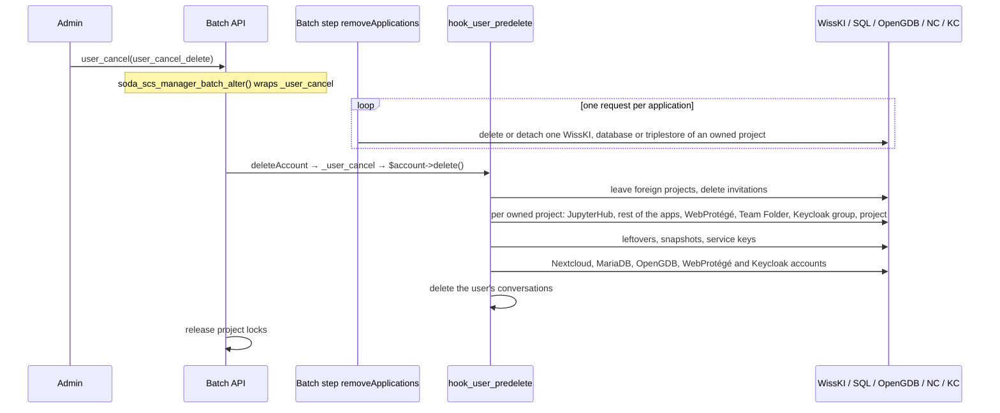

# SCS Manager — user create and delete routines

Technical reference for how the SCS Manager (`soda_scs_manager` Drupal module) provisions and tears down users across Keycloak, Nextcloud, MariaDB, OpenGDB, WebProtégé, and related SCS entities.

The host clone `scs-manager-stack/volumes/drupal-root/web/modules/custom/soda_scs_manager/` tracks `4.x` on `https://git.drupalcode.org/project/soda_scs_manager.git` and is not bind-mounted. Production loads `drupal/soda_scs_manager` `4.0.0` from `modules/contrib` (`composer require 'drupal/soda_scs_manager:^4.0'` inside `manager--drupal--app`). The previous `modules/custom` checkout is kept at `/var/scs-manager/soda_scs_manager-2x-before-4.0.0` so it no longer shadows contrib. That Composer change lives in the container layer and is gone after a recreate from the current image. Updates `11026`–`11036` were still pending after the switch.

## Identity model

| Layer | Identifier | Where stored |
|-------|------------|--------------|
| Keycloak | UUID (`sub` claim) | Keycloak user record |
| Drupal ↔ Keycloak | Same UUID | `authmap` table (`openid_connect.<client_id>`) |
| Nextcloud (OIDC) | Keycloak `sub` (raw UUID) | Nextcloud user backend (`user_oidc`) |
| WebProtégé (OIDC) | Sanitised Drupal/Keycloak account name (`[a-z0-9_.-]`, lowercase) | WebProtégé `UserId` string |
| Keycloak user attributes | `nextcloud_login_name`, `nextcloud_app_password`, `mariadb_password`, … | Keycloak user `attributes` |

`SodaScsProjectHelpers::getUserSsoUuid()` reads the Keycloak UUID from Drupal’s `authmap` after the user has logged in via OpenID Connect.

Nextcloud usernames for OIDC users are the Keycloak `sub` (raw UUID), e.g. `4e25a3ff-b955-4731-9c56-9e67a858828d`. SCS Manager setting `oidcUsernamePrefix` may prepend a string when non-empty — use the sentinel `{empty}` in config when no prefix is needed (a bare empty string is rejected as “not set”). It must match how `user_oidc` provisions accounts. Legacy installs may still have prefixed accounts (`keycloak-{sub}`) from the old **sociallogin** stack; see [Nextcloud Drive connection troubleshooting](../troubleshooting/nextcloud-drive-connect.md).

JupyterHub reads `nextcloud_login_name` and `nextcloud_app_password` from Keycloak **userinfo** (protocol mappers on the JupyterHub client). It does not derive the Nextcloud account from `sub` directly.

---

## User creation routines

### 1. Self-registration (pending → Keycloak)

**UI:** `KeycloakUserRegistrationForm` → route `soda_scs_manager.user_registration`

1. User submits registration (username, email, password, locale, timezone).
2. Row is inserted into custom table `keycloak_user_registration` with `status = pending`.
3. No Keycloak or Drupal account is created yet.

**Admin approval:** `KeycloakUserApprovalForm::approveRegistration()`

1. Obtain Keycloak admin token (`grant_type=password`, `client_id=admin-cli`, credentials from SCS Manager settings).
2. `POST {KC_URL}/admin/realms/{realm}/users` via `SodaScsKeycloakServiceUserActions::buildCreateRequest()`.
3. Body includes `username`, `email`, `firstName`, `lastName`, `credentials`, optional `attributes.locale`.
4. Registration row updated to `status = approved`; approval email sent.

Keycloak assigns a new UUID (`sub`) for the user. That UUID is **not** written to Drupal until the user logs in via OIDC.

### 2. First login — Drupal user (`hook_user_insert`)

When the approved user signs in through Keycloak (OpenID Connect), Drupal’s `openid_connect` module creates or links the Drupal account and writes the Keycloak `sub` into `authmap`.

`hook_user_insert()` then:

- Activates the user and assigns role `scs_user`
- Creates default project and applications
- Propagates Keycloak profile fields (locale, timezone) via `_soda_scs_manager_propagate_keycloak_user_data_to_fields()`

No Keycloak API call happens in this hook — the Keycloak user already exists.

### 3. Nextcloud account creation

Nextcloud accounts are **not** created by the Keycloak approval step. They appear when the user first authenticates against Nextcloud:

| Path | Mechanism | Resulting NC username |
|------|-----------|------------------------|
| Web login (Drive UI) | `user_oidc` → Keycloak | Raw Keycloak `sub` (auto-provision) |
| SCS Manager first-login wizard (recommended) | OIDC Bearer + `user_oidc` bearer-provisioning | Same raw `sub` |
| SCS Manager Connect popup (manual fallback) | Login Flow v2 → poll | `loginName` from the Drive account logged into in the popup |
| Bearer / API | `user_oidc` with `--bearer-provisioning=1` | Same raw `sub` |

The skeleton directory (`SCS-Share`, `Welcome.md`, …) is applied on **first** Nextcloud user creation via Nextcloud’s `skeletondirectory` config (see post-install hook).

### 4. Nextcloud credentials in Keycloak

Stored attributes (default names):

- `nextcloud_login_name`
- `nextcloud_app_password`

**Bearer SSO check (recommended)** — `SodaScsNextcloudConnectController::status()` when `useBearerToken` is enabled (default):

1. Calls `ensureCredentials()` (validates stored Keycloak attributes or creates an app password via Bearer token).
2. Returns `connected: true` only when credentials are actually ready for WissKI — not merely when the OIDC token validates.
3. The co-working intro wizard skips the Connect slide only when this status check succeeds.
4. When Bearer fails, the response includes `bearer_error` and the UI shows **Connect Drive manually** (Login Flow v2 popup). See [Nextcloud Drive connection troubleshooting](../troubleshooting/nextcloud-drive-connect.md).

Enable in SCS Manager settings: **Nextcloud → Use OIDC Bearer token for Nextcloud** (`nextcloud.generalSettings.useBearerToken`).

**Connect flow (Login Flow v2, manual fallback)** — `SodaScsNextcloudConnectController` when Bearer mode is disabled or automatic SSO failed:

1. `POST /index.php/login/v2` → user completes login in popup
2. Poll returns `loginName` + `appPassword`
3. Values are written to Keycloak via `setKeycloakUserAttributes()`
4. **Validation:** `loginName` must match the Keycloak `sub` (or `oidcUsernamePrefix` + `sub` when that prefix is configured) for the current Drupal user; otherwise the connect is rejected (HTTP 400).

**Bearer auto-provision** — `SodaScsNextcloudHelpers::ensureCredentials()` (when `useBearerToken` is enabled):

1. If validated stored credentials exist → return them
2. Else create app password via OIDC Bearer token → `GET /ocs/v2.php/core/getapppassword`
3. Persist username + app password to Keycloak attributes

**Validation on read** — `getValidatedStoredNextcloudCredentials()`:

- Stored username must match the Keycloak `sub` (with optional `oidcUsernamePrefix`; legacy `keycloak-{sub}` accounts are also accepted when the prefix was used historically)
- App password must still work against Nextcloud
- On mismatch or invalid password → attributes are **cleared** (user must reconnect)

**On login** — `hook_user_login()` calls `invalidateMismatchedStoredCredentials()` to drop stale attributes after Keycloak user recreation or SSO relinking.

### 5. MariaDB / phpMyAdmin credentials

When a user creates an SQL component or is granted project DB access:

- MariaDB user is created or updated
- `mariadb_password` is synced to Keycloak attributes (`SodaScsSqlComponentActions`, `SodaScsProjectDbAccessHelpers`)

phpMyAdmin SSO reads `preferred_username` and `mariadb_password` from the JWT. See [DBMS SSO troubleshooting](../troubleshooting/dbms-sso-redirect-loop.md).

### 6. Other provision-on-use resources

| Resource | Created when | Deleted when |
|----------|--------------|--------------|
| OpenGDB / triplestore user | Triplestore component; when the account is gone (for example deleted by an administrator), the next triplestore creates it again with a new token and read and write grants on the owner's existing repositories | User delete (account offboarding); a component delete removes only that repository's read and write grants |
| WissKI stack | WissKI component via Portainer | Component/stack delete |
| Keycloak groups/clients | WissKI component setup | WissKI component delete |
| WebProtégé ontology project | SCS project create (REST `POST /data/projects`) | SCS project delete (REST `DELETE /data/projects/{id}` → trash) |

The WebProtégé **application** remains a single shared instance (`soda_scs_webprotege_component` per user). Only the ontology project UUID is stored on the SCS project (`webprotegeProjectId`). Members receive `EDIT` when a membership request is approved; leave/remove revokes that access (the owner is never revoked). Failures are logged and shown in the messenger; they do not block SCS project create.

**Backfill existing projects** (this environment and later scs-prime), after the API key is set and `drush updb` has installed `webprotegeProjectId` (update 11028):

```bash
scs-drush soda_scs_manager:backfill-webprotege-projects --dry-run --all
scs-drush soda_scs_manager:backfill-webprotege-projects --all
```

Idempotent: already linked projects only re-grant member `EDIT`. Owner is set as `projectOwner` on create (`CAN_MANAGE`); members get `EDIT`. Do not run this from `hook_update_N` — it needs a live WebProtégé and the service API key.

The project-page WebProtégé card deep-links with `?project=` to `#projects/{uuid}/perspectives/69df8fa8-4f84-499e-9341-28eb5085c40b`. The dashboard card has no project context and opens `#projects/list`.

API key and optional Docker-internal API base URL live in SCS Manager settings (WebProtégé tab). Generate the key with `docker exec -it webprotege--webprotege--app java -jar /webprotege-cli.jar generate-api-key`; do not commit it.

---

## User deletion routines

### Trigger

Cleanup runs only when a **Drupal user is deleted** in SCS Manager: the profile delete form, the account cancel forms (single and bulk, method "Delete the account …"), the link in the cancellation confirmation e-mail, or `drush user:cancel`. All of them go through core `user_cancel()`, which deletes the account in the batch operation `_user_cancel`. Blocking an account removes nothing.

Deleting a user directly in the Keycloak Admin Console does **not** run any of this. Nextcloud, MariaDB and Drupal data are then **not** cleaned up automatically.

The forms refuse while a project the account owns is locked, i.e. being set up by the demo job or deleted (`SodaScsUserOffboarding::lockedProjects()`), and ask before projects that still have other members are deleted.

### Deletion sequence



### Step-by-step

1. **Applications, one per request** — `hook_batch_alter()` replaces every `_user_cancel` that deletes an account by `SodaScsUserOffboardingBatch::removeApplications()` and `::deleteAccount()`:
   - `removeApplications()` takes the project lock of each owned project through `lock.persistent` (`SodaScsUserOffboarding::lockProjectsForAccountDelete()`). If one is busy (demo job or project delete running), it removes nothing and `deleteAccount()` refuses the account delete with a message.
   - It removes one application per request with `SodaScsProjectApplicationRemover::removeNextApplication()`: WissKI stacks of the account are deleted with their database and triplestore, then its loose databases and triplestores; an application of another member only loses the link to the project. A failure moves on to the next project; step 2 tries again.
   - `deleteAccount()` runs core `_user_cancel()` with the locks still held and releases them afterwards.

2. **`hook_user_predelete`** — `SodaScsUserOffboarding::purge()`, inside the account delete transaction; a failing step is logged and the rest goes on:
   - Leaves the projects the account only belongs to (`detachMember()`, which also revokes its access there) and deletes its invitations.
   - Per owned project (demo projects under the demo lock): JupyterHub stack, the remaining applications (`removeApplications($project, FALSE)`), WebProtégé component, project mount, Team Folder, WebProtégé project (trash), Keycloak project group, the project.
   - Leftovers: owned components and stacks that are not in another owner's project, snapshots, service keys.
   - Personal accounts: Nextcloud (unmount the Drive, then `deleteNextcloudAccountForKeycloakUser()`), MariaDB user, OpenGDB user, WebProtégé user, Keycloak user (admin token, then `DELETE /admin/realms/{realm}/users/{userId}`; skipped without an `authmap` link).
   - The user's conversations.

### API route configuration

Keycloak Admin API paths are configured in SCS Manager settings (Keycloak tab → Users → CRUD). Typical values:

| Setting | Example |
|---------|---------|
| Base URL | `/admin/realms/{realm}/users` |
| Create URL | (empty or `/`) → `POST` creates user |
| Delete URL | `/{userId}` → `DELETE` removes user |

Token URL and realm come from the same Keycloak settings block (`initKeycloakGeneralSettings()`, `initKeycloakUsersSettings()`).

---

## Configuration checklist

| Setting | Purpose |
|---------|---------|
| Keycloak → Admin username / password | Admin API token for create/delete user |
| Keycloak → Users → delete URL | Path segment for `DELETE` (usually `/{userId}`) |
| Nextcloud → Base URL | OCS API base |
| Nextcloud → OIDC username prefix | Must match `user_oidc` provisioning (`{empty}` = raw Keycloak `sub` on this deployment) |
| Nextcloud → Admin username / password | Optional; required for automatic NC user delete on Drupal user delete |
| Nextcloud → Keycloak attribute names | Defaults: `nextcloud_login_name`, `nextcloud_app_password` |
| JupyterHub → Notebook container name prefix | Default `jupyter-`; must match DockerSpawner naming (`jupyter-{drupalAccountName}`) |
| WebProtégé → Host | Public WebProtégé URL |
| WebProtégé → API base URL | Optional Docker-internal origin (`http://webprotege:8080`); falls back to host |
| WebProtégé → API key | Service-account key with `CREATE_EMPTY_PROJECT`; leave blank on save to keep the current value |

---

## Known gaps and pitfalls

### Orphaned accounts after manual Keycloak changes

If a Keycloak user is deleted or recreated **outside** SCS Manager (Admin UI, import, realm reset):

- Drupal `authmap` may still point to the old or a new `sub`
- Nextcloud may retain old `keycloak-{old-sub}` accounts
- Keycloak attributes (`nextcloud_login_name`, …) may reference the **wrong** Nextcloud account

**Symptom:** User sees correct files in Nextcloud web UI but JupyterHub (or other services reading Keycloak userinfo) sync to a different Nextcloud account. Common when a legacy `keycloak-{sub}` account coexists with the current `user_oidc` account (raw `sub`), or when the Jupyter single-user server was spawned before Keycloak credentials were updated (respawn from the Hub after reconnecting Drive).

**Mitigation (module behaviour):**

- Login invalidates mismatched Nextcloud attributes
- Connect flow refuses wrong `loginName`
- `getValidatedStoredNextcloudCredentials()` clears stale attributes

**Operational fix:** User re-runs Nextcloud Connect in SCS Manager; optionally delete orphaned Nextcloud users manually.

### Nextcloud delete requires admin API credentials

Without Nextcloud admin username/password in SCS Manager settings, user deletion only revokes the app password and clears Keycloak attributes. The Nextcloud user directory remains until deleted manually (`occ user:delete` or Admin UI).

### Registration approval ≠ Drupal account

Approving registration creates the Keycloak user only. The Drupal account appears on first OIDC login. Nextcloud and Keycloak credential attributes are provisioned later (Connect flow or Bearer auto-provision).

---

## Manual operations

### Delete Keycloak user (without Drupal cleanup)

```bash
# Token
curl -s -X POST "${KC_URL}/realms/master/protocol/openid-connect/token" \
  -d "grant_type=password" -d "client_id=admin-cli" \
  -d "username=${KC_ADMIN}" -d "password=${KC_ADMIN_PASSWORD}"

# Delete
curl -X DELETE "${KC_URL}/admin/realms/${KC_REALM}/users/${KEYCLOAK_UUID}" \
  -H "Authorization: Bearer ${TOKEN}"
```

Prefer deleting the **Drupal user** in SCS Manager so Nextcloud, SQL, and SCS entities are cleaned up.

---

## Entity access control

| Entity | View | Edit / delete | Create snapshot |
|--------|------|----------------|-----------------|
| Project | Owner or project member | Owner only | — |
| Component | Any user with `view soda scs component` | Owner only (`owner` field) | Owner of the component only |
| Stack | Any user with `view soda scs stack` | Owner only (`owner` field) | Owner of the stack only |
| Snapshot | Owner only | Owner only | Via component/stack routes (owner of source entity) |

Project members can use shared components and stacks (e.g. via the dashboard) but cannot change, remove, or snapshot entities they do not own. Edit, delete, and snapshot tabs, list operations, and form routes enforce this via the entity access handlers.

Users with `soda scs manager admin` or the entity-specific `administer soda scs * entities` permissions bypass owner checks (full edit, delete, and snapshot access).

### Delete Nextcloud user

```bash
docker exec nextcloud--nextcloud--app php /var/www/html/occ user:delete "keycloak-${KEYCLOAK_UUID}"
```

Or configure Nextcloud admin credentials in SCS Manager and rely on `hook_user_delete()`.

---

## Related documentation

- [Keycloak and Nextcloud integration](../post-configuration/keycloak-nextcloud.md) — OIDC, Bearer tokens, audience mapper
- [Post-configuration checklist](../post-configuration/checklist.md) — Keycloak clients, groups, Nextcloud Social Login
- [WissKI stack integration](wisski-stack/index.md) — Portainer-based stack create/delete
- [DBMS SSO redirect loop](../troubleshooting/dbms-sso-redirect-loop.md) — `mariadb_password` and phpMyAdmin
