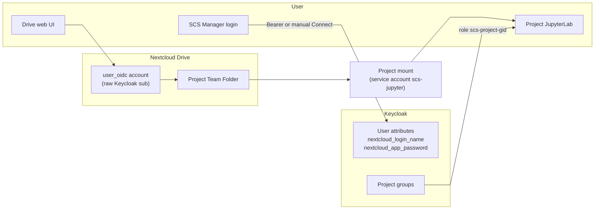

# SCS Drive connection and project notebooks — troubleshooting

Runbook when the Drive (Nextcloud) connection fails, credentials need to be renewed, or a project notebook does not show its folder. Covers **SCS Manager**, **Keycloak**, **Nextcloud**, and **JupyterHub**.

For deeper technical background see [SCS Manager user lifecycle](../service-infrastructure/scs-manager-user-lifecycle.md#4-nextcloud-credentials-in-keycloak), [Keycloak ↔ Nextcloud](../post-configuration/keycloak-nextcloud.md), [Nextcloud Drive connection](nextcloud-drive-connect.md), and [Nextcloud mount sidecar](../service-infrastructure/nextcloud-mount-sidecar.md#jupyterhub-one-shared-lab-per-project).

## How it fits together



| Component | Role |
|-----------|------|
| **Keycloak** | Stores `nextcloud_login_name` and `nextcloud_app_password` on the user record (written by SCS Manager), and the project groups (`gid = entityId + 10000`). |
| **SCS Manager** | Provisions and validates the Drive credentials (Bearer SSO or manual Connect popup), mounts project Team Folders through the service account, and manages the project servers on JupyterHub. |
| **Nextcloud** | Drive account via `user_oidc`; every project has a Team Folder. |
| **JupyterHub** | One shared JupyterLab per project with JupyterHub. It binds the project mount, not the user's Drive, so it does **not** depend on the user's Drive connection. Access comes from the project groups. |

## Quick reference — who does what

| Task | User | Admin |
|------|:----:|:-----:|
| Log out and back in to SCS Manager / Drive / JupyterHub | ✓ | |
| Reconnect Drive in SCS Manager (Connected Accounts) | ✓ | |
| Open the project notebook from the project's JupyterHub card | ✓ | |
| Start, stop or restart the project notebook (card health icon) | ✓ | |
| Fix duplicate legacy `keycloak-{sub}` Drive accounts | | ✓ |
| Set `oidcUsernamePrefix` (`{empty}` vs `keycloak-`) | | ✓ |
| `occ files:scan`, `occ user:delete`, migrate SCS-Share | | ✓ |
| Fix Keycloak audience mapper / `user_oidc` provider | | ✓ |
| Mount or set up a project notebook (Drush) | | ✓ |
| Rebuild the Jupyter spawner image | | ✓ |

## Symptoms → first steps

| Symptom | Likely cause | First action |
|---------|--------------|--------------|
| SCS Manager: *Connecting Drive via SSO failed* | Bearer token rejected by Nextcloud | User: **Connect Drive manually**; Admin: check [Keycloak ↔ Nextcloud](../post-configuration/keycloak-nextcloud.md) audience / `user_oidc` |
| Drive UI and SCS Manager show different accounts | Duplicate legacy account or prefix mismatch | Admin: see [duplicate accounts](#fix-duplicate-legacy-accounts) |
| Project notebook: *You are not a member of this project* | Keycloak group not synced yet | Admin: check the user in the project's Keycloak group; the launcher re-reads it on every call |
| Project notebook: *The project folder is being prepared* | Project mount missing or broken | Admin: `scs:nextcloud-project-status`, then `scs:nextcloud-project-mount --project=<id>` |
| Project notebook: *JupyterHub is not enabled for this project* | Hub user `project-<gid>` missing | Admin: `scs:jupyter-backfill-project-servers` |
| Project notebook: *Personal notebook servers are disabled* | Opened JupyterHub directly and clicked a personal server | User: open the notebook from the project page in SCS Manager or from the hub home list |

## Users — renew the connection

### 1. SCS Manager — reconnect Drive

1. Log in to [SCS Manager](https://manager.scs.sammlungen.io) with Keycloak (same account as always).
2. Open **Connected Accounts** (`/user/{your-uid}/connected-accounts`) or the co-working intro Drive step.
3. If status is not connected:
   - Wait a few seconds (Bearer auto-provision may run), or
   - Click **Connect Drive manually**, sign in in the popup with the **same Keycloak account** as SCS Manager.
4. Confirm status shows connected (username should be your Keycloak `sub` UUID on this deployment, not `keycloak-…` unless your site still uses the legacy prefix).

### 2. JupyterHub — open the project notebook

1. Open the project in SCS Manager and click the **JupyterHub** card. It opens the project's shared JupyterLab and starts it when it is stopped.
2. The project folder is under `nextcloud/<project name>` in the file browser.
3. If the Lab misbehaves, restart it from the card's health icon. This affects all members of the project: open documents are saved automatically, but running kernels and terminals are lost.

New members and renamed projects need no restart: access follows the Keycloak group, and the folder is bound from its parent mount.

### 3. Nextcloud Drive — refresh SSO session (if Connect popup fails)

1. Log out of Drive completely.
2. Open Drive login → **SCS SSO Login** → sign in with the same Keycloak account.
3. Retry **Connect Drive manually** in SCS Manager.

### 4. Keycloak — user session refresh

Usually fixed by logging out of SCS Manager and Drive and logging back in. Users do **not** edit Keycloak directly.

If problems persist after admin fixes, log out of all SCS services and clear site cookies for `auth.*`, `manager.*`, `drive.*`, `code.*`, then log in again.

## Admins — diagnosis and repair

### Verify the Drive chain

Replace `{username}`, `{sub}`, `{drupal-uid}` with the affected account.

```bash
# 1. Drupal / Keycloak sub
docker compose exec -T scs-manager--drupal drush user:information {username}

# 2. Keycloak credentials (via module — no secrets printed)
docker compose exec -T scs-manager--drupal drush ev "
\$u = \Drupal\user\Entity\User::load({drupal-uid});
\$h = \Drupal::service('soda_scs_manager.nextcloud.helpers');
\$p = \Drupal::service('soda_scs_manager.project.helpers');
\$s = \$p->getUserSsoUuid(\$u);
\$c = \$h->getValidatedStoredNextcloudCredentials(\$u);
echo 'sub: ' . \$s . PHP_EOL;
echo 'expected: ' . \$h->expectedNextcloudUsernameForKeycloakId(\$s) . PHP_EOL;
echo 'stored: ' . (\$c['username'] ?? 'INVALID') . PHP_EOL;
"

# 3. Nextcloud accounts (look for duplicate keycloak-{sub} AND raw {sub})
docker exec --user www-data nextcloud--nextcloud--app php occ user:list | grep {sub-fragment}
```

### Verify a project notebook

```bash
scs-drush scs:jupyter-project-status          # mount and server state per project
scs-drush scs:nextcloud-project-status        # project mounts only
docker inspect jupyter-project-{gid} --format '{{range .Mounts}}{{.Source}} -> {{.Destination}}{{println}}{{end}}'
```

### Fix duplicate legacy accounts

See [Nextcloud Drive connection — duplicate accounts](nextcloud-drive-connect.md#duplicate-nextcloud-accounts-legacy-mismatch). Summary:

1. Copy `SCS-Share` from `keycloak-{sub}` to `{sub}` if needed.
2. `occ files:scan` on the target user.
3. `occ user:delete keycloak-{sub}`.
4. User reconnects Drive.

### Fix `oidcUsernamePrefix` mismatch

This deployment uses raw Keycloak `sub` for `user_oidc`. SCS Manager must use the `{empty}` sentinel:

```bash
docker compose exec -T scs-manager--drupal drush config:set \
  soda_scs_manager.settings nextcloud.generalSettings.oidcUsernamePrefix '{empty}' -y
```

### WebDAV missing files after host-side copy

```bash
docker exec --user www-data nextcloud--nextcloud--app php occ files:scan \
  {sub} --path=/{sub}/files/SCS-Share
```

## What to restart (and what not to)

| Action | When | Affects |
|--------|------|---------|
| **User: log out/in SCS Manager + Drive** | Stale OIDC token, Bearer 401 | One user |
| **Member: restart the project notebook (card)** | Lab hangs, extension errors | All members of that project |
| `docker compose restart scs-manager--drupal` | Drupal/SCS Manager code or config cache issues | All Manager users |
| `docker compose restart jupyterhub--jupyterhub--app` | Hub config / authenticator changes | **Stops all project notebooks** |
| `docker compose restart nextcloud--nextcloud--app` | Nextcloud app/config changes | All Drive users |
| `docker compose restart keycloak--keycloak--app` | Realm/client mapper changes | All SSO users |
| Rebuild `jupyterhub--spawner--builder` | Spawner image changes | Project notebooks started afterwards |

**Default for “Drive connection broken for one user”:** reconnect in SCS Manager — **no** stack restart required.

## Admin-only Keycloak checks

When Bearer connect fails for **all** users:

1. Nextcloud client in Keycloak has **audience** mapper so tokens include Drive client id in `aud`.
2. `user_oidc` provider: `--check-bearer=1`, `--bearer-provisioning=1` ([Keycloak ↔ Nextcloud §2.4](../post-configuration/keycloak-nextcloud.md)).
3. `config.php`: `oidc_provider_bearer_validation` = true, `bearer_validation_azp_check` = false.
4. The JupyterHub client needs the `groups` claim; it no longer needs the Nextcloud credential mappers.

Users never edit Keycloak Admin; admins fix realm/client configuration once.

## Related pages

- [Nextcloud Drive connection](nextcloud-drive-connect.md) — Bearer vs manual, duplicates
- [Nextcloud mount sidecar](../service-infrastructure/nextcloud-mount-sidecar.md) — project mounts and project notebooks
- [SCS Manager user lifecycle](../service-infrastructure/scs-manager-user-lifecycle.md)
- [Keycloak ↔ Nextcloud](../post-configuration/keycloak-nextcloud.md)
- [JupyterHub spawn failure](jupyterhub-spawn-failure.md)
