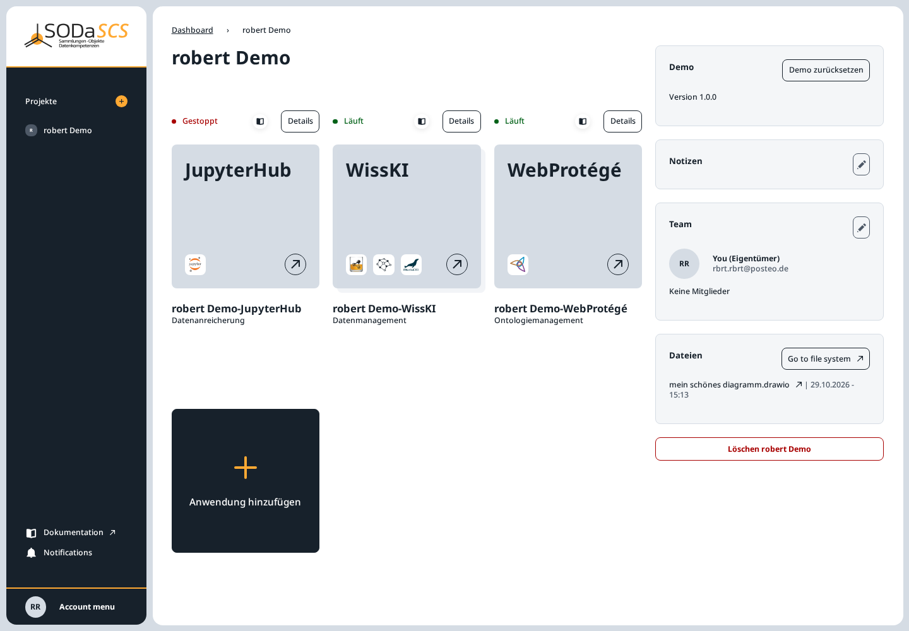
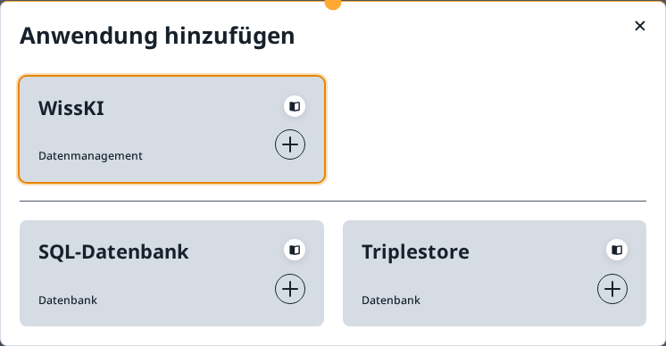
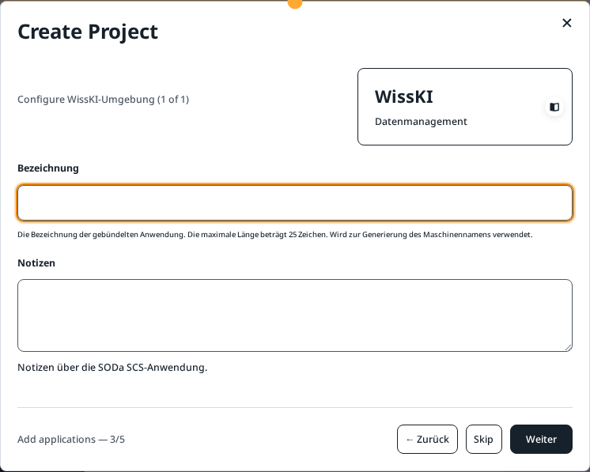
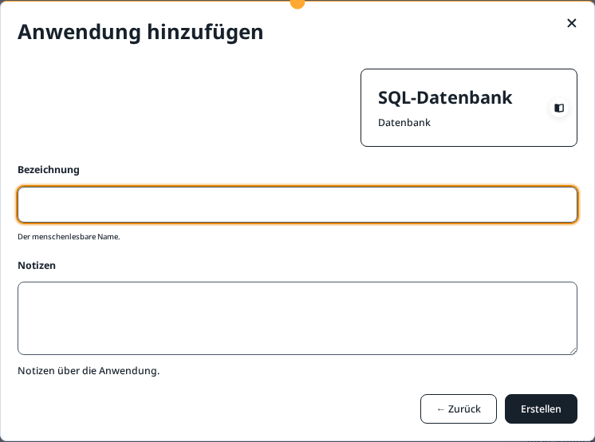

# Applications

Profiles of the services themselves: [JupyterHub with OpenRefine](apps/jupyter.md), [MariaDB with phpMyAdmin](apps/mariadb.md), [Nextcloud with OnlyOffice and draw.io](apps/nextcloud.md), [OpenGDB](apps/opengdb.md), [WebProtégé](apps/webprotege.md), [WissKI Environment](apps/wisski.md).

Applications belong to a project. You open them from the card on the project page. The arrow on the card opens the application in a new tab. **Details** opens the application's page in SCS Manager.

The demo project **robert Demo** contains three applications:

| Card | Kind | In the example |
|---|---|---|
| **JupyterHub** | data enrichment | **Gestoppt** until you open it. It then starts, and it stops after about an hour without use. All members share this lab. |
| **WissKI** | data management | **Läuft**. The environment includes the database and the triplestore for this WissKI. |
| **WebProtégé** | ontology management | **Läuft**. Opens this project's ontology. |

The dot in front of the status is red for **Gestoppt** and green for **Läuft**. **Startet** means the application is being set up or is starting.

On the right of the page:

- **Notizen** — the note from the wizard. The pencil opens **Notizen** for editing.
- **Team** — owner and members. See [Project members](members.md).
- **Dateien** — the latest changes in the project folder. **Go to file system** opens the folder in SCS Drive. The same folder is usable in JupyterHub and WissKI, see [Project files](project-files.md).
- **Löschen** — owner only. While other members are in the project, they have to be removed first. Deleting takes the project and its applications back and cannot be undone.

## Add an application

The black card **Anwendung hinzufügen** opens the chooser.

In the demo project, JupyterHub and WebProtégé are already there. Each exists only once per project, so they are missing from the chooser. You can still add WissKI, an SQL database, and a triplestore.

A card opens the form. **← Zurück** returns to the chooser without creating anything.

### WissKI

A **Bezeichnung** of at most 25 characters, plus optional notes. The future address appears under the label. A WissKI environment includes its database and its triplestore. Setup takes several minutes. The card shows **Startet** until then.

In the wizard used while creating a project, the form looks like this:

### JupyterHub

Also once per project, with a label like WissKI. The lab uses the project folder. In the file browser it is under `nextcloud/<project name>`. Personal files from other folders are not visible there. More is in [Project files](project-files.md).

### WebProtégé

Once per project. Members receive access once they accept the invitation. The card opens this project's ontology.

### SQL database

**Bezeichnung** is the name you see on the card. **Notizen** are optional. **Erstellen** creates the database. This is a database of its own, next to the one a WissKI environment already includes.

### Triplestore

The same form: **Bezeichnung**, **Notizen**, **Erstellen**. This too is an additional triplestore, not the one inside the WissKI environment.

!!! warning "Nothing is created until Erstellen"
    Closing the window or choosing **← Zurück** creates nothing. **Erstellen** starts setup immediately.
