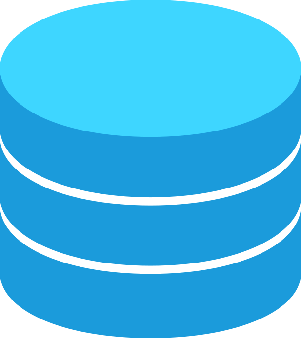

# MariaDB with phpMyAdmin

<figure class="scs-figure">
  
</figure>

## Overview

MariaDB is an open-source relational database management system that serves asside of the OpenGDB triplestore as on of the primary data storage engines for structured data. MariaDB is a drop-in replacement for MySQL, offering high performance, security, and scalability for storing application data, user information, and system configurations.

## Possibilities

MariaDB databases are created and managed as individual applications and can be managed through the phpMyAdmin database management software. This is the place to import and export, and query your data.

## Additional Ressources

- [phpMyAdmin Documentation (englisch)](https://www.phpmyadmin.net/docs/)
- [MariaDB Documentation](https://mariadb.org/documentation/)

## Links

- [Website of the PhpMyAdmin database management software](https://www.phpmyadmin.net/)
- [Website of the MariaDB database management system](https://mariadb.org/)
- [Homepage of the SCS PhpMyAdmin service](https://adminer.scs.sammlungen.io/)
