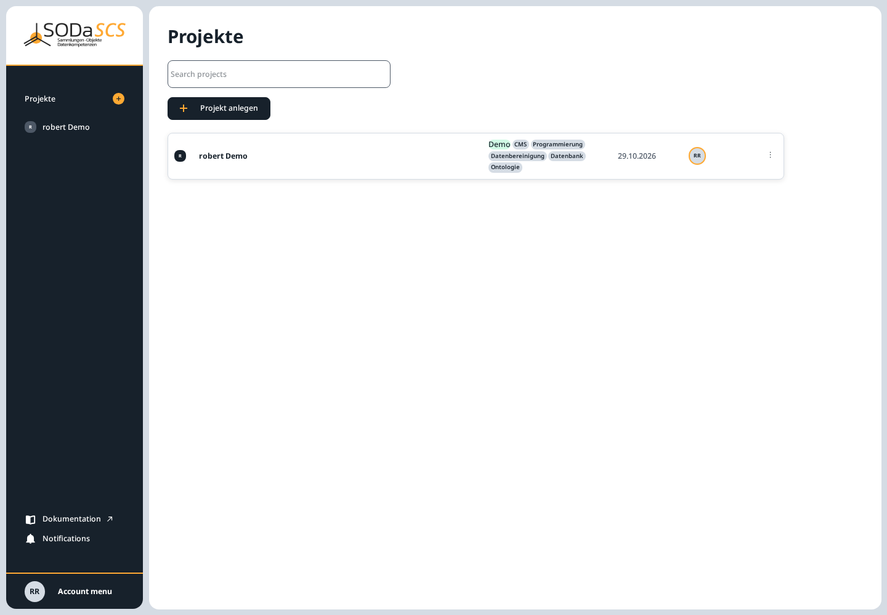
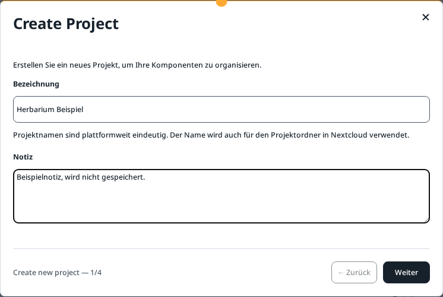
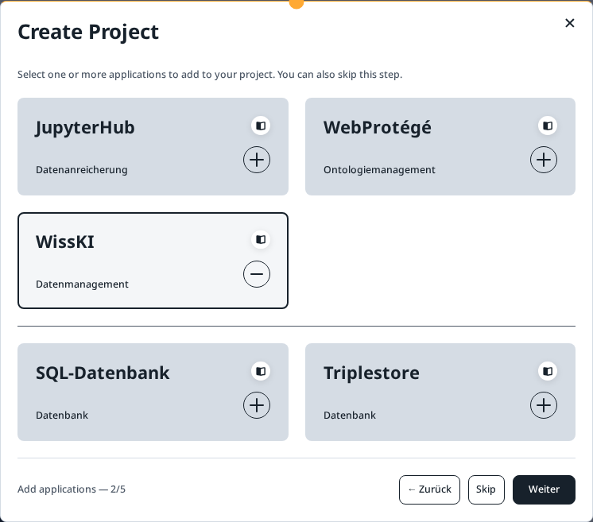
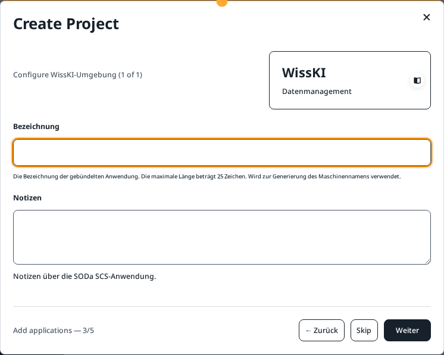
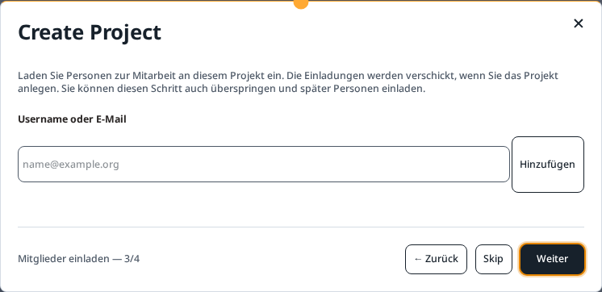
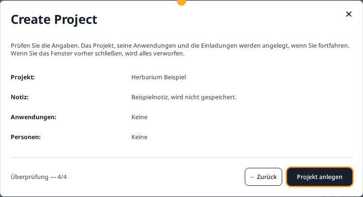
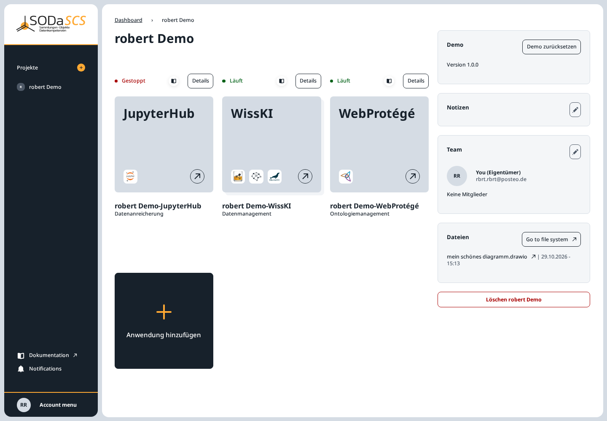

# Create a project

A project bundles applications, the shared folder in SCS Drive, and the team. Every application belongs to a project. You are the owner.

On **Projekte**, **Projekt anlegen** is at the top. The same button is the plus next to **Projekte** in the sidebar.

The card shows the name, tags of the applications inside, the date, and your initials. A click on the card opens the project.

## Wizard

**Projekt anlegen** opens a wizard. Nothing is saved until you choose **Projekt anlegen** on the last page. Closing the window before that discards everything.

How many steps you see depends on whether you select applications. Without applications there are four steps. Each selected application adds a step for naming it.

### 1. Name and note

- **Bezeichnung** is the project name. It must be unique across the platform, and it becomes the name of the project folder in Nextcloud.
- **Notiz** is free text. It shows later on the project page.

**Weiter** goes to the next step. **← Zurück** is disabled on the first page.

### 2. Choose applications

Select one or more cards. A second click clears the selection. **Skip**, or **Weiter** with nothing selected, leaves the project without applications. You can add applications later on the project page.

| Application | For | How often |
|---|---|---|
| **JupyterHub** (Datenanreicherung) | Notebooks and computing, the project's shared folder | once per project |
| **WebProtégé** (Ontologiemanagement) | the project's ontology | once per project |
| **WissKI** (Datenmanagement) | an environment for collection data, with its own database and triplestore | more than once |
| **SQL-Datenbank** (Datenbank) | your own relational database, in addition to WissKI | more than once |
| **Triplestore** (Datenbank) | your own triplestore, in addition to WissKI | more than once |

The book icon on a card opens the short help for that application.

### 3. Name the application

If you selected at least one card, a form follows for each.

For **WissKI** and **JupyterHub** the **Bezeichnung** is at most 25 characters. The application address is built from it and appears under the field once the name has been checked. **Notizen** are optional. **Skip** drops this one application. **Weiter** keeps it for the check at the end.

SQL database and triplestore ask for a label and notes in the same way. A WissKI environment already includes a database and a triplestore. The two cards below those are extra, standalone applications.

### 4. Invite people

Enter the **Username oder E-Mail** of someone who already has an SCS account, and choose **Hinzufügen**. The invitation is sent only when you actually create the project. You can pass the step with **Skip** or with **Weiter** and an empty field, and invite people later on the project page. How they accept is described in [Project members](members.md).

### 5. Check and create

The check lists name, note, applications, and people. In the picture, applications and people are empty because both steps were skipped. If you selected any, they are listed here.

**Projekt anlegen** creates the project, starts the selected applications, and sends the invitations. WissKI needs several minutes for that. The project page shows progress on the cards (**Läuft**, **Startet**, **Gestoppt**).

## Demo project

As long as you do not have a demo project yet, the first step has two tabs: **Neu** and **Demo**. **Demo** does not create an empty project. It creates one with WissKI, JupyterHub, and WebProtégé, and with sample data. The button is **Demo-Projekt anlegen**. Setup takes a few minutes. The tab then disappears. There is no second demo project per account.

The result looks like this:

At the top right are the status **Demo**, the version, and **Demo zurücksetzen**.

!!! warning "Reset the demo"
    Reset overwrites every change in the WissKI, the databases, the triplestores, the Jupyter home directory, the team folder, and the WebProtégé ontology of this project with the demo data. Applications you added yourself stay. This cannot be undone.

The introduction on first sign-in offers the same start (**Oder mit einem Demo-Projekt starten**).
