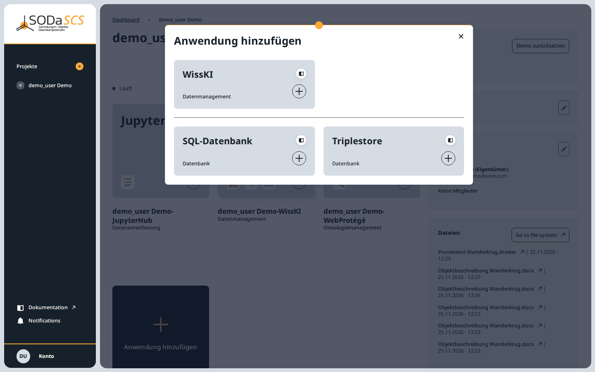
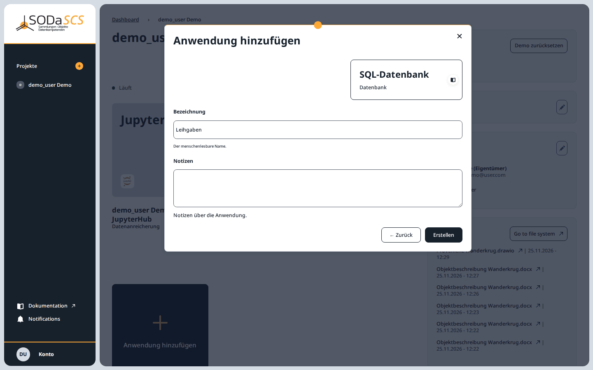
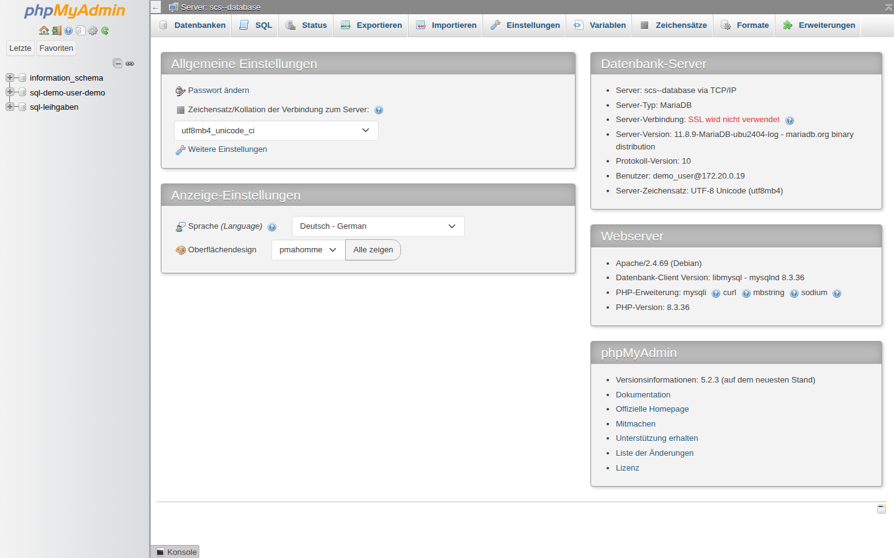
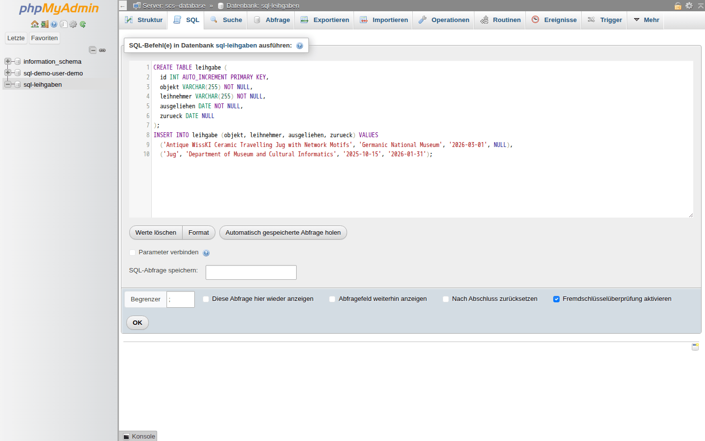
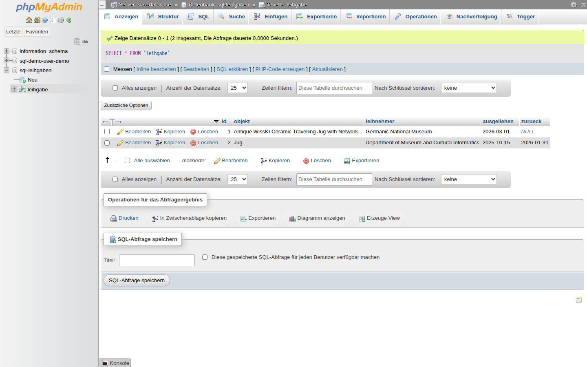
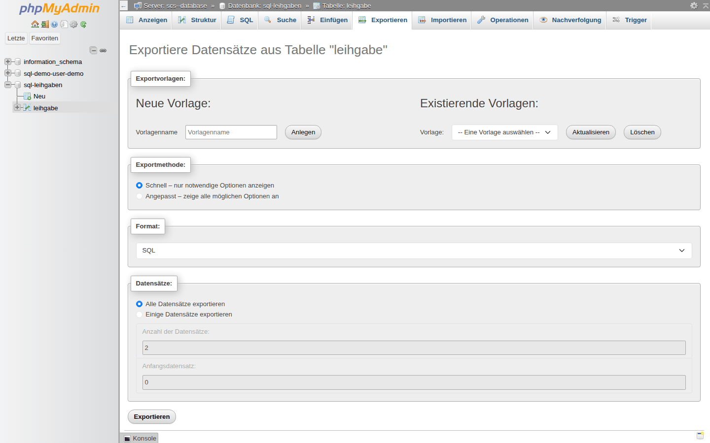
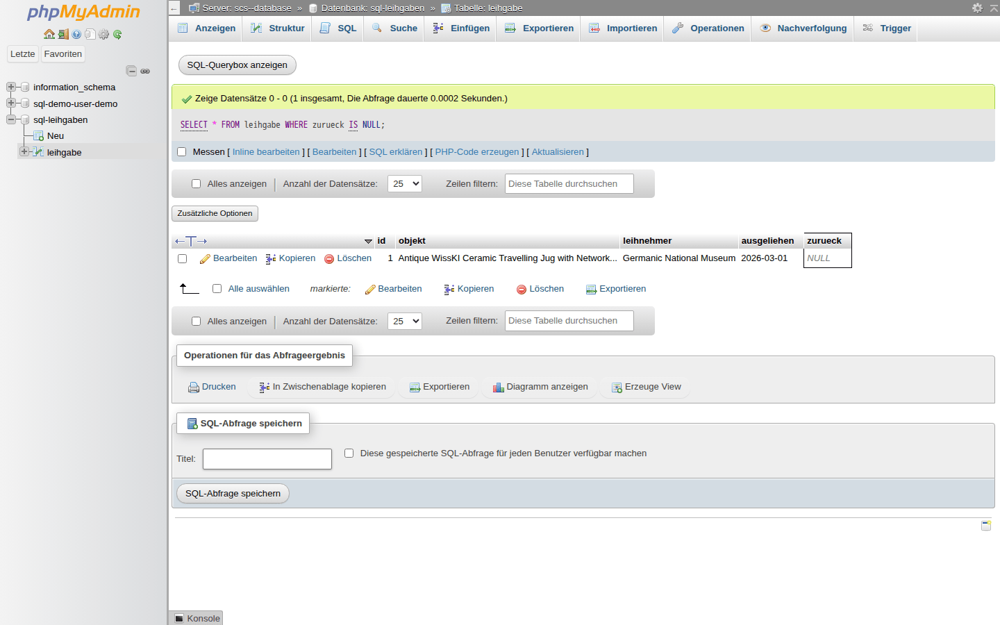

# Databases

A project can have SQL databases of its own, next to the database a WissKI environment already includes. What the service is: [MariaDB with phpMyAdmin](../apps/mariadb.md).

## Create a database

1. Open the project, for example the demo project.
2. Choose the black card **Anwendung hinzufügen**.
3. Choose **SQL-Datenbank**.

    

4. Enter a **Bezeichnung**, for example `Leihgaben` (loans). **Maschinenname** is filled from it. **Notizen** are optional.
5. Choose **Erstellen**.



The database appears as a card *Leihgaben (SQL-Datenbank)* on the project page. More on the form: [Applications](../applications.md#sql-database).

## Manage it in phpMyAdmin

The arrow on the card opens phpMyAdmin. If asked, sign in with your SCS account; there is no separate database password to enter.

On the left are your databases: the new one as `sql-leihgaben`.



A click on a database opens it. The tabs at the top:

- **SQL** runs SQL statements. The quickest way to create a table: paste the statement and choose **OK**.

    ```sql
    CREATE TABLE leihgabe (
      id INT AUTO_INCREMENT PRIMARY KEY,
      objekt VARCHAR(255) NOT NULL,
      leihnehmer VARCHAR(255) NOT NULL,
      ausgeliehen DATE NOT NULL,
      zurueck DATE NULL
    );
    INSERT INTO leihgabe (objekt, leihnehmer, ausgeliehen, zurueck) VALUES
      ('Antique WissKI Ceramic Travelling Jug with Network Motifs', 'Germanic National Museum', '2026-03-01', NULL),
      ('Jug', 'Department of Museum and Cultural Informatics', '2025-10-15', '2026-01-31');
    ```

    

- **Struktur** lists the tables. Without the SQL tab, a new table is created there under **Neue Tabelle erstellen**: name, number of columns, then name, type (`INT`, `VARCHAR`, `DATE` …) and whether it may be empty for each column.
- **Anzeigen** (in a table) shows its rows. **Bearbeiten** next to a row changes it, **Löschen** deletes it.

    

- **Einfügen** adds a row through a form.
- **Importieren** loads an `.sql` or `.csv` file. A CSV from the team folder is downloaded from the drive first, for example `materials_gnd.csv` from the demo.
- **Exportieren** saves the database or a table, format **SQL** for a backup or **CSV** for a spreadsheet.

    

A query in the tab **SQL**, for example all loans not yet returned:

```sql
SELECT * FROM leihgabe WHERE zurueck IS NULL;
```



**Details** on the database's card opens its page in SCS Manager. There, **Snapshots** saves the state of the database and lists earlier snapshots.

!!! info "Triplestore: coming soon"
    The chooser already shows **Triplestore** (OpenGDB). Triplestores as applications of their own are in preparation. Until then, the triplestore of a WissKI environment holds its linked data.
