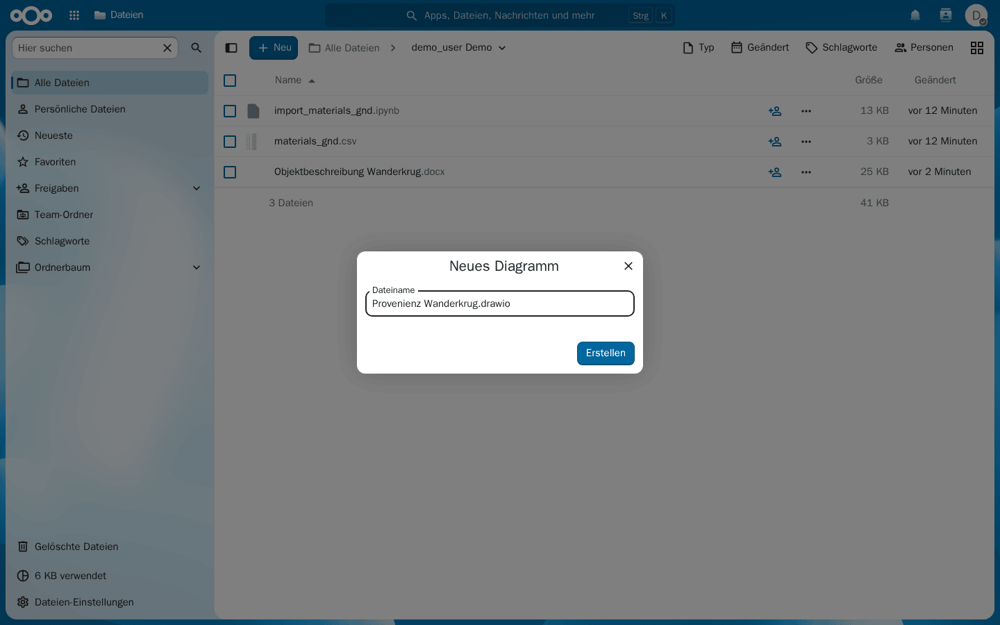
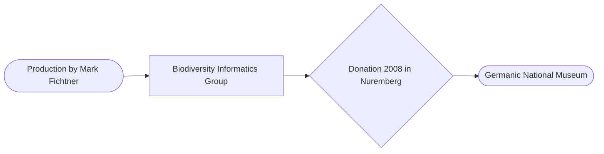

# Diagrams with draw.io

draw.io is built into the SCS Drive. You do not open it on its own: you create and open diagrams like any other file in the drive.

## Create a diagram

1. Open the drive from the project page: **Dateien → Go to file system**.
2. In the team folder, choose **+ Neu → Neues Diagramm**.
3. Enter a name, for example `Provenienz Wanderkrug.drawio`, and choose **Erstellen**.

The file opens in the draw.io editor. Later, a click on any `.drawio` file opens it again.

## Draw a simple flowchart

As an example, draw the provenance of the demo object *Antique WissKI Ceramic Travelling Jug with Network Motifs*, as recorded in the demo WissKI:

1. On the left, open the shape library **Allgemein** (general) or **Flussdiagramm** (flowchart).
2. Drag a rounded shape onto the page for the start: *Production by Mark Fichtner*. Double-click it to type the text.
3. Add a rectangle *Biodiversity Informatics Group*, a diamond *Donation 2008 in Nuremberg* and a rounded shape *Germanic National Museum*.
4. Connect them: move the mouse over a shape, then drag one of the blue arrows onto the next shape. The arrow sticks to both shapes and moves with them.
5. With a shape selected, the panel on the right changes colour, line and text.

Save with **Strg+S** (Ctrl+S) or **Datei → Speichern**. The exit button at the top right closes draw.io and takes you back to the folder.

## Work together

The diagram lies in the team folder, so every project member can open it. If several people have it open at the same time, draw.io shows the changes of the others and merges them when someone saves. Save often, so the others see your changes.

Leave a note in the diagram itself, for example a text shape *to be checked*, or comment on the file in the drive under **Details**.

## Share a diagram

Share a `.drawio` file like any other file, see [Share a file or folder](drive.md#share-a-file-or-folder).

For people without an SCS account, export the diagram: **Datei → Exportieren als → PNG**, **SVG** or **PDF**. The export lands in the same folder and can be shared with a link.
