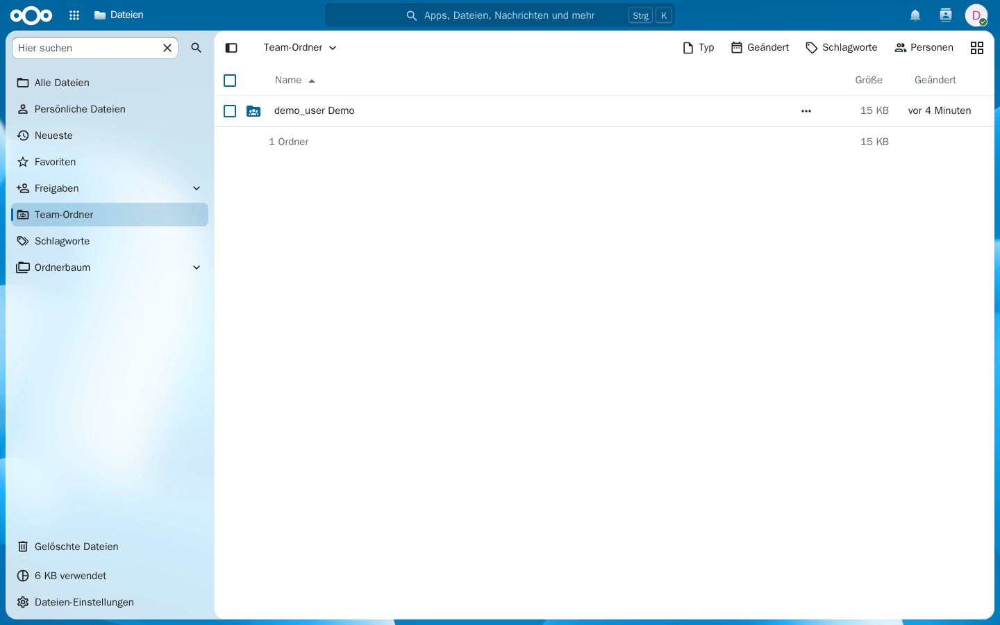
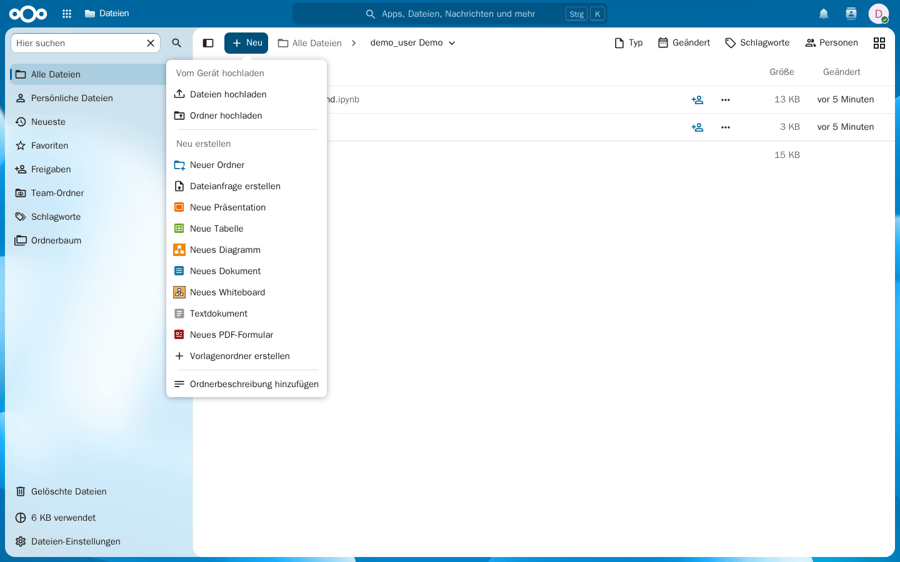
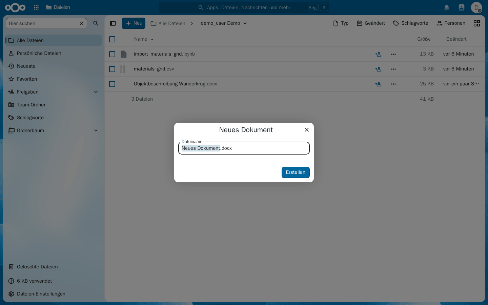
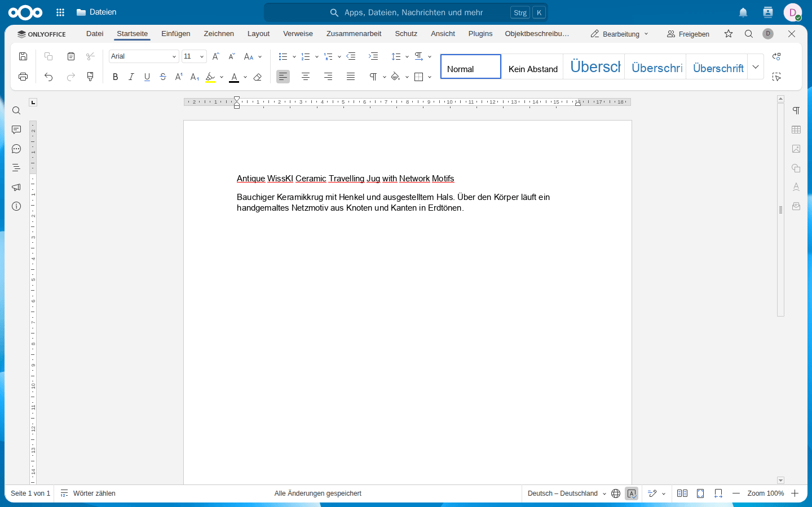
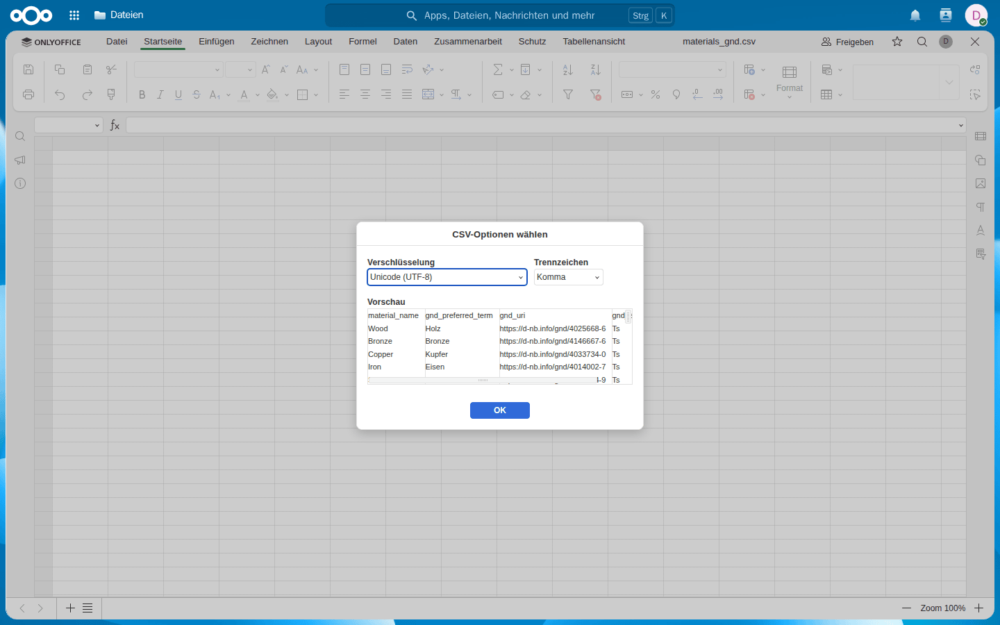
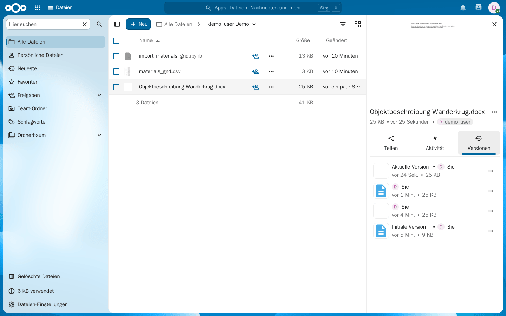
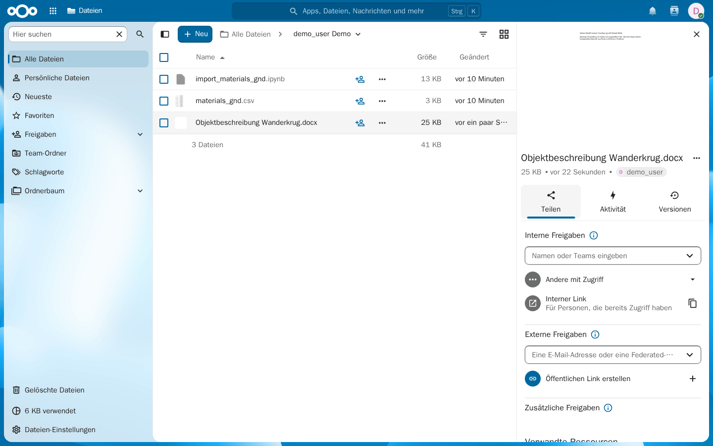

# SCS Drive (Nextcloud)

SCS Drive is the platform's Nextcloud. It stores your files and opens office documents in the browser with OnlyOffice. What the service is: [Nextcloud with OnlyOffice and draw.io](../apps/nextcloud.md).

You open the drive from the project page: **Dateien → Go to file system**. It opens the project folder directly.

## The team folder

Every project has a team folder with the project's name. In the pictures it is **demo_user Demo**; yours is called after your demo project. Every member sees it under **Team-Ordner** in the drive, without anyone sharing it. New members get it once they accept the invitation; removed members lose it.

The demo's team folder contains `import_materials_gnd.ipynb` and `materials_gnd.csv`. The same folder is the project folder in JupyterHub and WissKI, see [Project files](../project-files.md).

- Put everything the project works on into the team folder, not into your personal folders.
- Files in your personal folders stay private, unless you share them.
- Deleting a file in the team folder deletes it for all members. It goes to **Gelöschte Dateien** (deleted files) and can be restored there for a while.

## Create a document

1. Open the team folder.
2. Choose **+ Neu** at the top.
3. Under **Neu erstellen**, choose **Neues Dokument** (text), **Neue Tabelle** (spreadsheet) or **Neue Präsentation**.
4. Enter a name, for example `Objektbeschreibung Wanderkrug`, and choose **Erstellen**.

The document opens in OnlyOffice. It is saved as `.docx`, `.xlsx` or `.pptx`.

## Edit a document

A click on the file opens it in the editor. OnlyOffice saves while you type: the status bar at the bottom shows **Alle Änderungen gespeichert**. The **×** at the top right closes the editor.

A CSV file does not open with a click. Use **⋯ → In ONLYOFFICE öffnen**. OnlyOffice first asks how to read it, in **CSV-Optionen wählen**: keep **Unicode (UTF-8)** and **Komma** and choose **OK**.

Try it with `materials_gnd.csv` from the demo: it has the columns `material_name`, `gnd_preferred_term`, `gnd_uri` and `gnd_entity_type`. The notebook in [JupyterHub](jupyter.md) reads this file, so keep the columns as they are.

To go back to an earlier state, open the file's details (**⋯ → Details**), tab **Versionen**. Each version can be restored there.

## Work together

Several people can edit the same document at once.

1. Both open the same file in the team folder.
2. The other person's avatar appears at the top right of the editor. Their cursor and their changes show up in the text with their name.
3. Mark text and add a comment from the tab **Zusammenarbeit** (collaboration) to leave a note for the others. Replies go into the same thread.

There is nothing to merge afterwards: everyone edits the same file.

## Share a file or folder

Members of the project already see the team folder. To give a file to someone outside the project, choose the share icon next to the file. The tab **Teilen** opens on the right.

- **Interne Freigaben:** type the name of an SCS user or team into **Namen oder Teams eingeben** and choose them from the list. Under the person you set what they may do, for example edit.
- **Externe Freigaben → Öffentlichen Link erstellen:** creates a link. Anyone with the link can open the file. In the link's menu you can set a password, an expiry date and whether people may edit.

To end the sharing, open **Teilen** again and remove the person or the link.

!!! tip "Links for OpenRefine"
    A public link opens a preview page. To load the file itself, for example in OpenRefine, add `/download` to the link: `https://drive.scs.sammlungen.io/s/<id>/download`.
