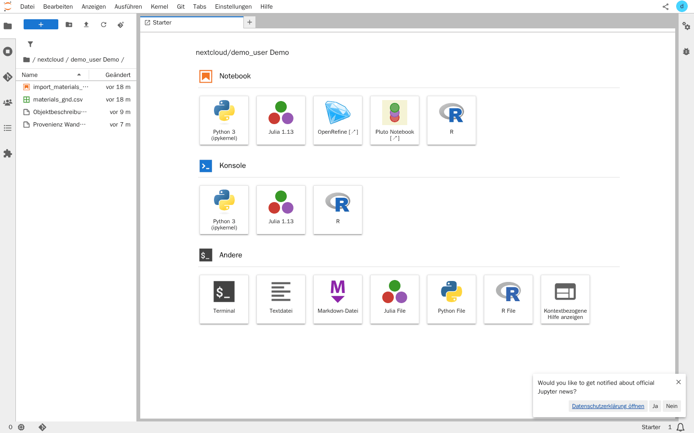
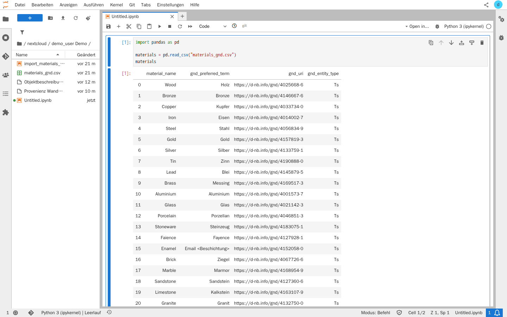
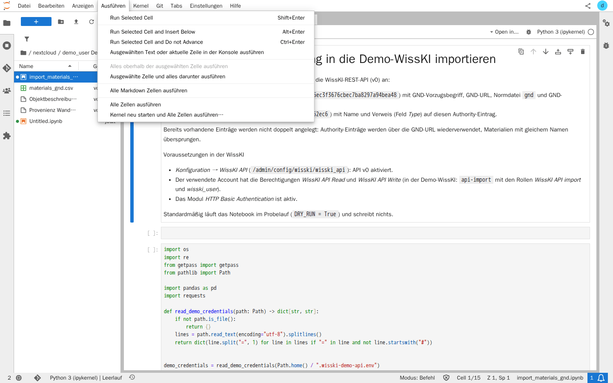
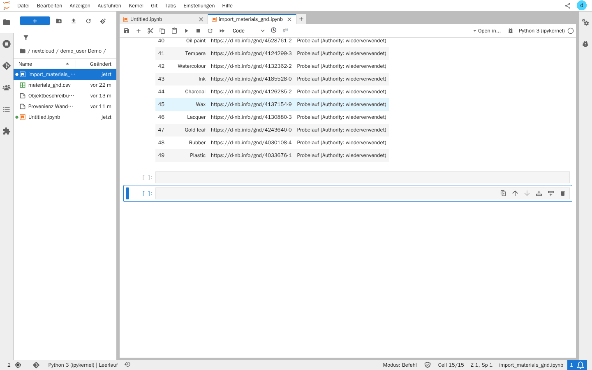
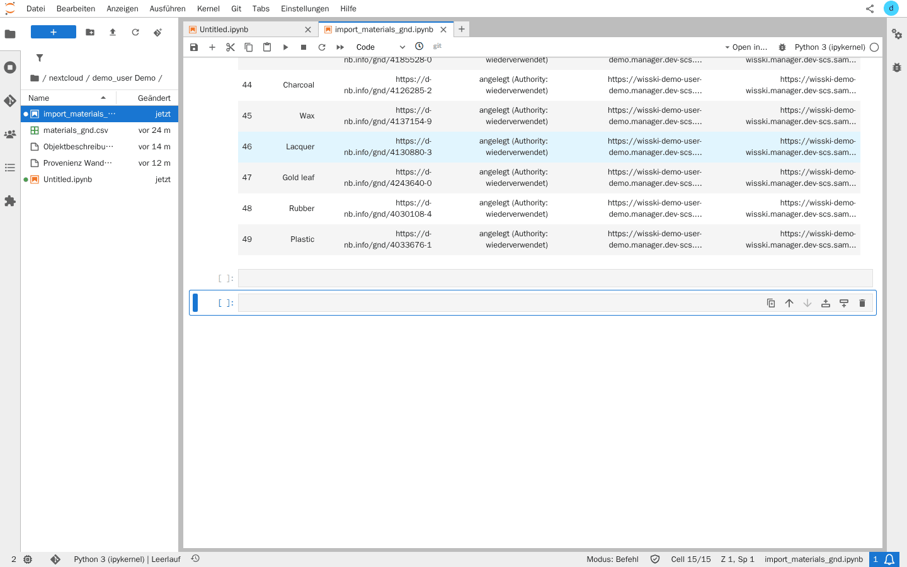

# JupyterHub

Each project has one JupyterLab, shared by all members. What the service is: [JupyterHub with OpenRefine](../apps/jupyter.md).

## Open the lab

1. On the project page, choose the arrow on the **JupyterHub** card.
2. JupyterHub asks you to sign in: choose **Sign in with SODa SCS Login**.


If the card says **Gestoppt**, the lab starts now; that takes a moment. It stops on its own after about an hour without use.

The lab opens in the project folder `nextcloud/<project name>`, here `nextcloud/demo_user Demo`. It is the same folder as the team folder in the drive and `project_files` in WissKI, see [Project files](../project-files.md).



- Notebooks and data for the project belong in this folder. The other members find them there, and so does the drive.
- The home directory around it belongs to the lab. It is shared by all members of the project too, but it is not in the drive.

## Create a notebook

1. In the file browser, open `nextcloud/demo_user Demo`.
2. In the **Starter** tab (or **+** at the top left for a new one), choose a kernel under **Notebook**: **Python 3 (ipykernel)**, **Julia** or **R**. The Starter also opens **OpenRefine**.

The new notebook is called `Untitled.ipynb`. Right-click it in the file browser and choose **Umbenennen** (rename) to give it a name, for example `materialien.ipynb`.

## Run code

A notebook consists of cells. A code cell holds code, a Markdown cell holds text.

1. Type into the first cell:

    ```python
    import pandas as pd

    materials = pd.read_csv("materials_gnd.csv")
    materials
    ```

2. Press **Shift+Enter**. The cell runs, its result appears below it, and the cursor moves to the next cell. The demo CSV shows as a table with the materials and their GND records.



3. To turn a cell into text, select it and choose **Markdown** in the toolbar, or press **M**.

More commands are in the menu **Ausführen** (run): **Alle Zellen ausführen** runs the whole notebook from the top, **Kernel neu starten und Alle Zellen ausführen…** starts fresh first.



The notebook saves itself every few minutes. **Strg+S** (Ctrl+S) saves at once.

## Work together

All members of the project work in the same lab. If two people open the same notebook, each sees the other's cursor with their name, and edits show up while they are typed, as in an online document.

- The variables of a notebook are shared too: whoever runs a cell changes the state for everyone in that notebook.
- Before you restart the kernel or run everything, tell the others.
- Files changed in the drive appear in the lab after about 30 seconds. If someone edits the same file in the drive and in the lab at once, the last save wins.

## Write to WissKI through the API

The demo shows how a notebook writes into the WissKI. The team folder holds `import_materials_gnd.ipynb`. It reads `materials_gnd.csv` and creates through the WissKI REST API (v0):

1. one **Authority data** record (Normdaten) per row, with the GND term, the GND URL and the GND entity type,
2. one **Material** per row, which points to that authority record.

Records that exist already are not created twice: authority records are matched by their GND URL, materials by their name.

To run it:

1. Open `import_materials_gnd.ipynb` in the project folder.
2. Choose **Ausführen → Alle Zellen ausführen**. The notebook first runs as a dry run (`DRY_RUN = True`). It writes nothing; at the end it says *PROBELAUF – nichts geschrieben* and lists, for each row, what it would do.

    

3. To write for real, set `DRY_RUN = False` in the first code cell and run all cells again. Each row now has the status *angelegt* (created).

    

4. In the WissKI, open the list of materials (**Browse → Material**). The new materials are there, each with its GND record.

To try it with your own data, add a row to `materials_gnd.csv`. Take the GND URI of the material from the [GND](https://explore.gnd.network/), in the form `https://d-nb.info/gnd/<number>`.

The access data for the demo WissKI are in `~/.wisski-demo-api.env`, in the lab's home directory and not in the team folder. The notebook reads them from there, so the password never appears in the notebook.

!!! info "For your own WissKI"
    The API must be enabled in the WissKI under **Konfiguration → WissKI → WissKI API** (`/admin/config/wisski/wisski_api`). The account the notebook uses needs the permissions *WissKI API Read* and *WissKI API Write* and a local Drupal password: the SCS sign-in does not work for the API. The lab also has the Python package `wisski_py` installed, a client for the same API.
