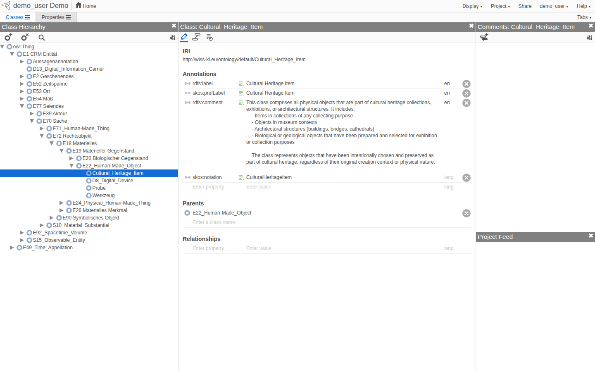
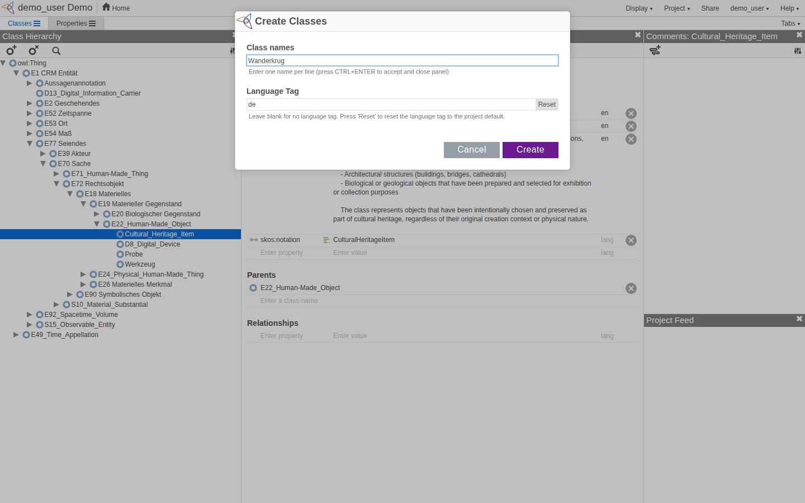
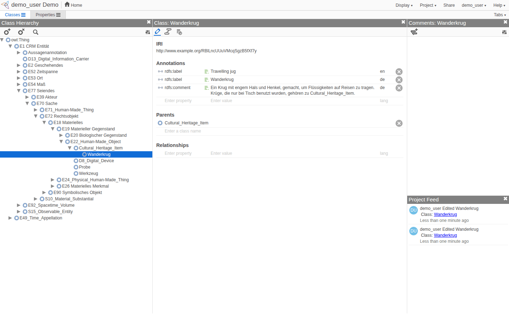
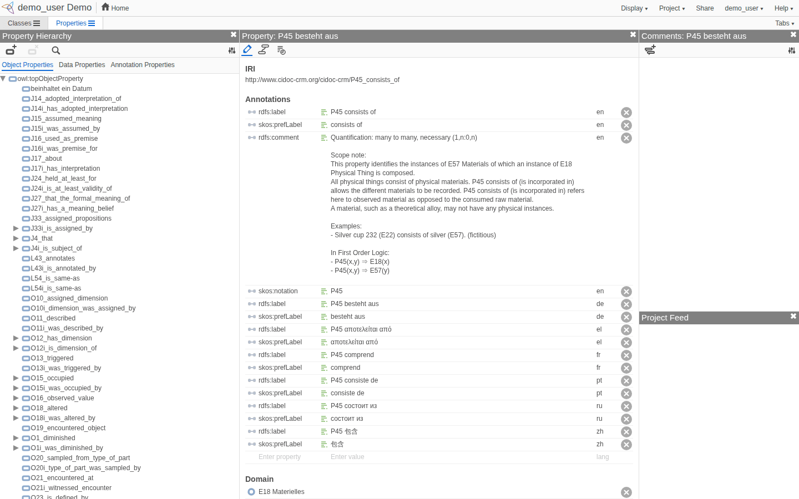
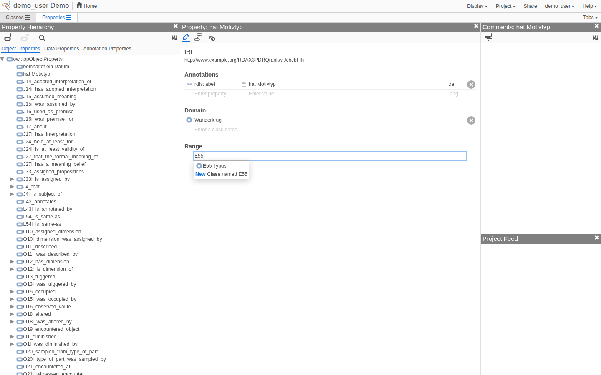
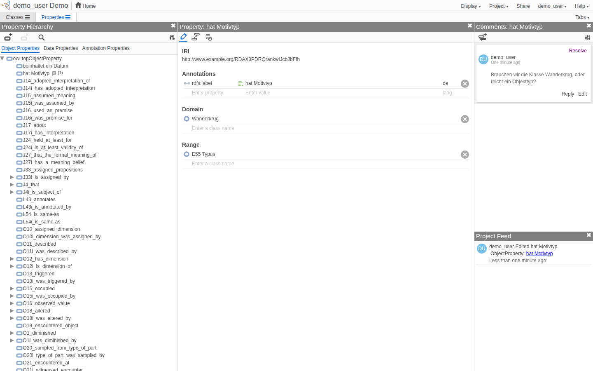
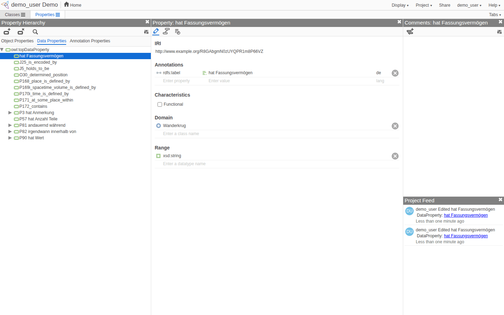
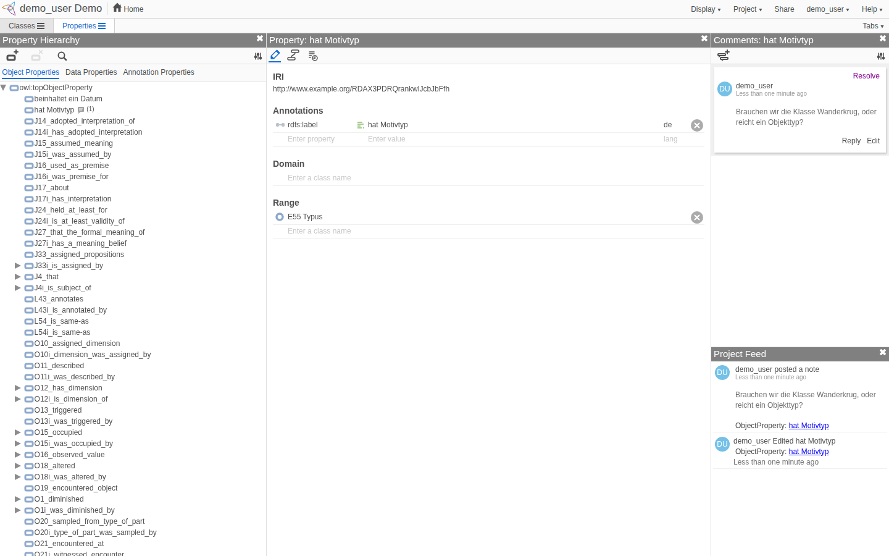
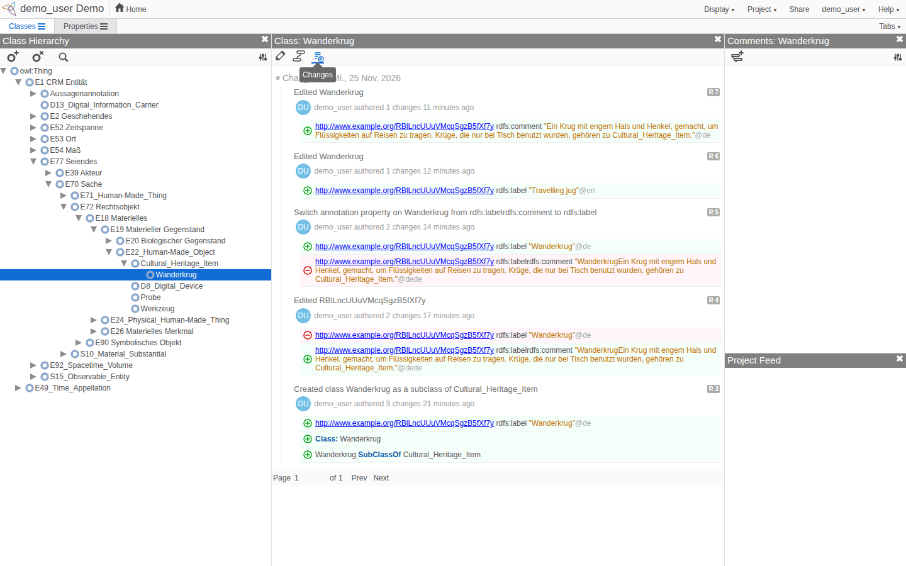
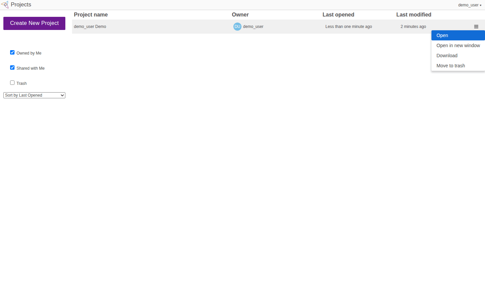

# WebProtégé

WebProtégé edits ontologies in the browser. What the service is: [WebProtégé](../apps/webprotege.md).

Open it from the **WebProtégé** card on the project page. It opens this project's ontology. The demo ontology is the one behind the demo WissKI: CIDOC CRM with its extensions (CRMdig, CRMsci, CRMinf), LRMoo and the WissKI default ontology, about 260 classes and 550 properties.

WebProtégé's interface is in English. Where a class has a German label, the tree shows it, for example *E1 CRM Entität*.

## The ontology of a project

Each project has one ontology in WebProtégé. It is created with the project; you do not create it yourself. There are two ways to fill it:

- **Build it up** class by class, as described below.
- **Import** an existing ontology file, see the section *Import an existing ontology* on [WebProtégé](../apps/webprotege.md).

The examples below extend the demo ontology. The demo is the right place to try: **Demo zurücksetzen** on the project page brings the ontology back.

## Classes and the hierarchy

The tab **Classes** shows the **Class Hierarchy** on the left: every class sits under its superclass. `owl:Thing` is the root. The three buttons above the tree create a class, delete the selected class and search.

To find a class, choose the magnifier and type a few letters, for example `Cultural`. **Search for Class** lists the hits; choose one and **Select**.

The editor in the middle shows the selected class: **IRI**, **Annotations**, **Parents** and **Relationships**. `Cultural_Heritage_Item` from the WissKI default ontology sits below CIDOC CRM `E22_Human-Made_Object`; its `rdfs:comment` says what belongs in it.

### Create a class

As an example, create a class for travelling jugs below `Cultural_Heritage_Item`:

1. Select `Cultural_Heritage_Item` in the tree.
2. Choose the first button above the tree (create class).
3. In **Create Classes**, enter `Wanderkrug` under **Class names**. One name per line creates several classes at once. **Language Tag** `de` makes the name the German label.
4. Choose **Create**.

The new class appears in the tree below `Cultural_Heritage_Item`, with the label *Wanderkrug*@de. Its IRI is generated by WebProtégé. To move a class to another superclass, drag it in the tree, or change **Parents** in the editor.

### Labels and scope note

Under **Annotations** in the editor, each row is a property, a value and a language:

1. In the empty row, type `rdfs:label` under **Enter property** and choose it from the list. Under **Enter value** type `Travelling jug`, under **lang** `en`.
2. In the next empty row, add `rdfs:comment` for the scope note: what belongs in this class and what does not, for example *Ein Krug mit engem Hals und Henkel, gemacht, um Flüssigkeiten auf Reisen zu tragen. Krüge, die nur bei Tisch benutzt wurden, gehören zu Cultural_Heritage_Item.*, language `de`.

Every edit is saved at once and shows up in the **Project Feed** on the right.

The scope note decides how others use the class. Look at CIDOC CRM as an example: the `rdfs:comment` of its classes and properties begins with *Scope note:*.

## Properties: domain and range

The tab **Properties** lists the properties in three sub-tabs:

- **Object Properties** link two individuals, for example an object and its material.
- **Data Properties** link an individual to a literal, a value such as a text, a number or a date.
- **Annotation Properties** add notes to classes and properties, such as `rdfs:label`, `rdfs:comment` or `skos:prefLabel`.

The **Domain** of a property is the class of the things it starts from. The **Range** is the class (or datatype) of what it points to. In the demo, `P45 consists of` (*P45 besteht aus*) has the domain `E18 Materielles` and the range `E57 Material`; its scope note explains the property.

### Create an object property

As an example, a property that links a travelling jug to the type of its motif:

1. In **Properties → Object Properties**, choose the create button above the tree. The new property becomes a sub-property of the selected one; with nothing selected, it is created at the top.
2. Enter `hat Motivtyp`, language tag `de`, and choose **Create**.
3. Under **Domain**, type `Wanderkr` into **Enter a class name** and choose *Wanderkrug* from the list.
4. Under **Range**, type `E55` and choose *E55 Typus* from the list.

Always pick from the list. The last entry, **New Class named …**, would create a new class instead of using the existing one. A name that is not in the list is marked *does not exist* and not saved.

### Create a data property with a literal

A data property points to a literal, not to a class:

1. In **Properties → Data Properties**, choose the create button and enter `hat Fassungsvermögen`.
2. Under **Domain** choose `Wanderkrug`.
3. Under **Range**, type into **Enter a datatype name** and choose the datatype `xsd:string`.

Other ranges are `xsd:integer` for whole numbers, `xsd:decimal` for numbers with decimals, `xsd:date` for a date and `xsd:anyURI` for an address. **Functional** under **Characteristics** means: at most one value per individual. The WissKI default data model uses `P3_has_note` with text for most of its values, for example for the inventory number.

Annotations are literals too: a label like `"Wanderkrug"@de` is a text with a language tag.

## Work together

Every member of the project can open the ontology, once they have accepted the invitation.

- Two people can edit at the same time. Every edit is saved at once; the **Project Feed** shows who changed what.
- **Comments:** select a class or property and choose the button in the **Comments** panel on the right to start a thread, for example *Brauchen wir die Klasse Wanderkrug, oder reicht ein Objekttyp?* Others answer with **Reply**; **Resolve** closes the thread. A speech bubble with a number in the tree marks entities with comments.
- **Changes:** the third button above the editor lists every revision of the selected class or property with author, time and the added (green) and removed (red) axioms.

## Download the ontology

**Home** at the top lists your projects. The menu **≡** at the end of a row has **Download**: it saves the ontology as a file, for example RDF/XML or Turtle.

The ontology in WebProtégé and the ontologies in the WissKI are separate copies: classes added in WebProtégé do not appear in the WissKI pathbuilder by themselves. Replacing the ontology of a WissKI is a task for administrators, see [The pathbuilder](wisski.md#the-pathbuilder).
