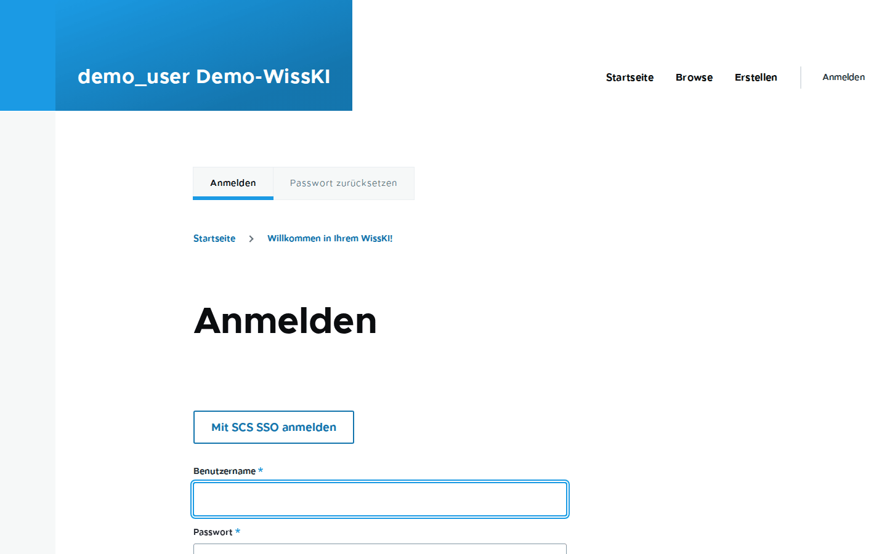
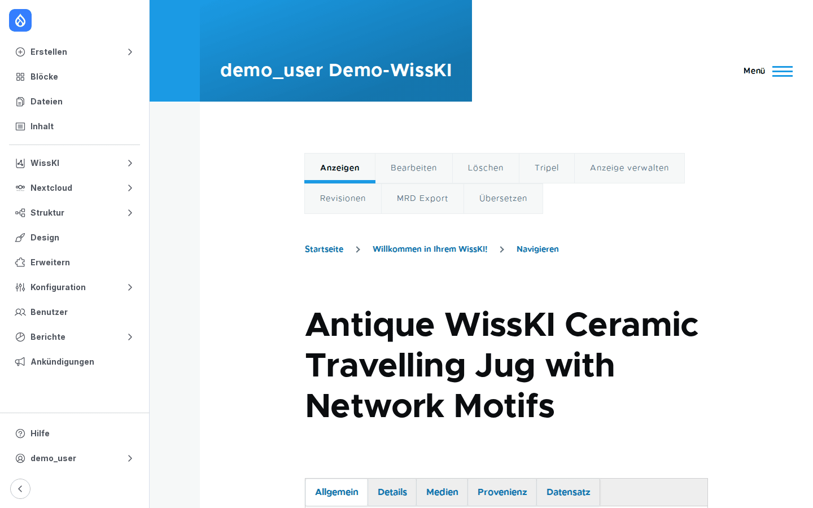
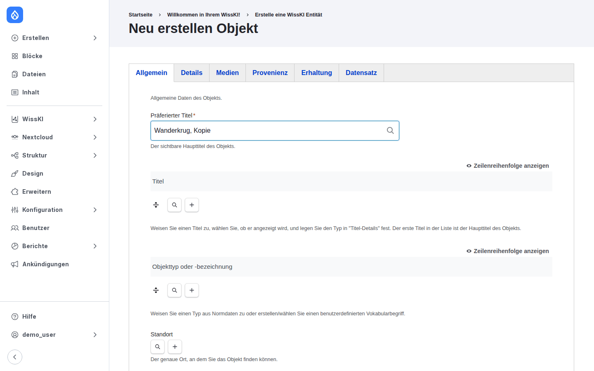
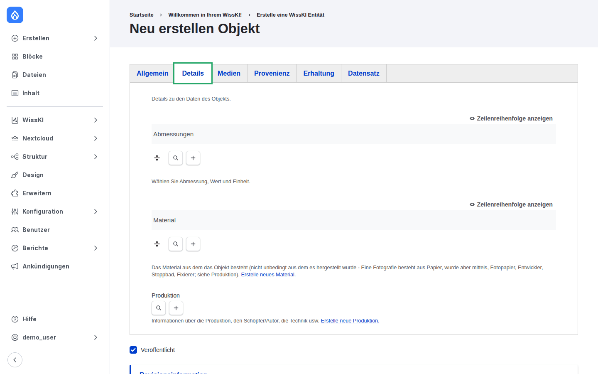
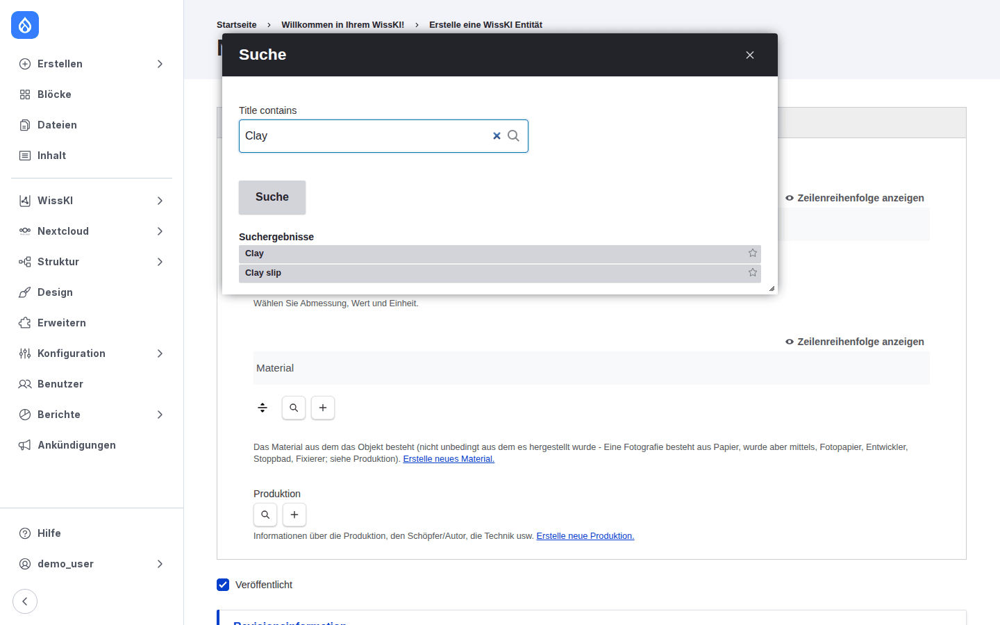
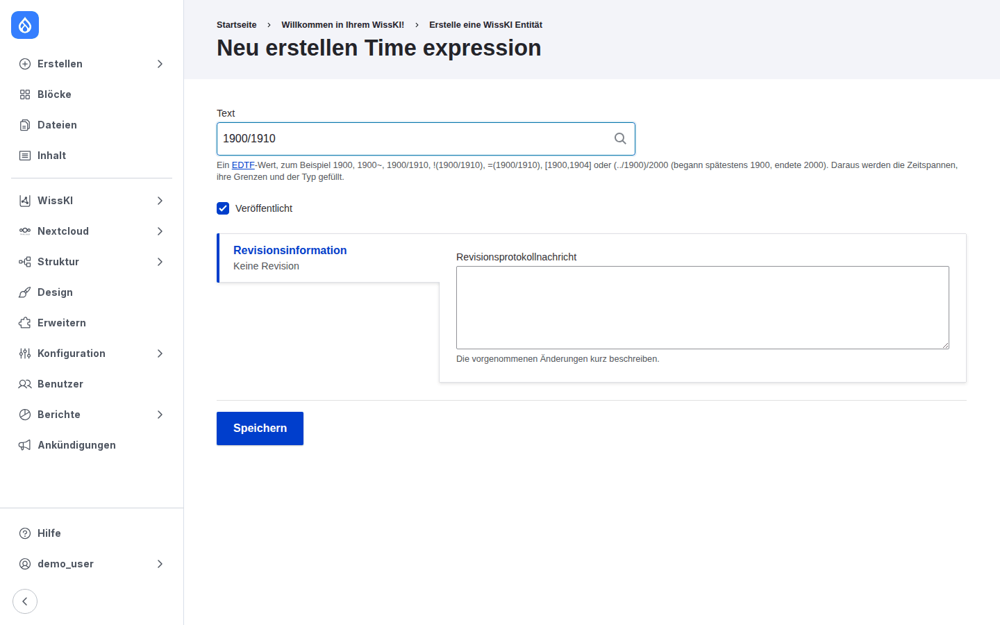
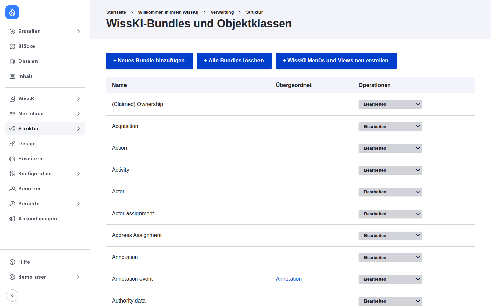
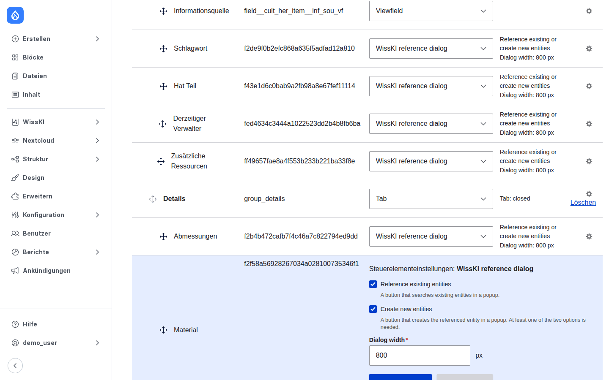
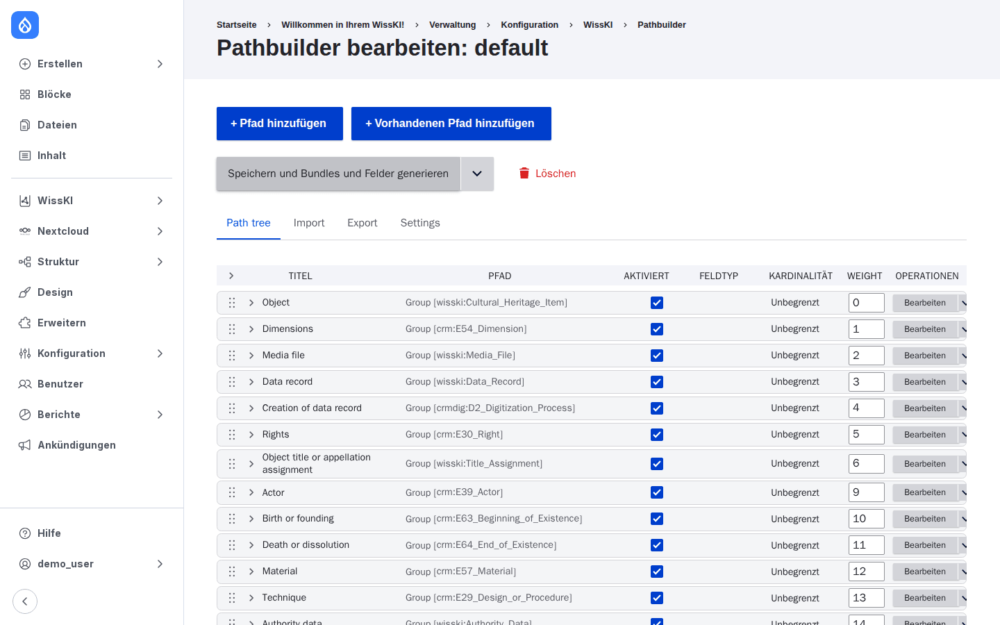
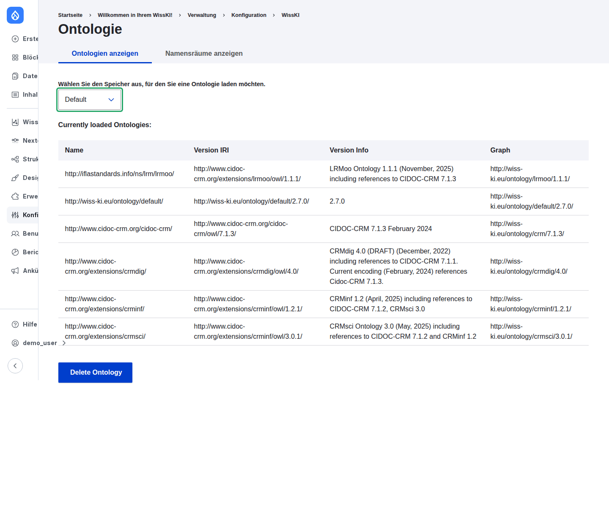

# WissKI

WissKI records objects and everything around them (people, places, events, materials) as linked data. What the service is: [WissKI Environment](../apps/wisski.md).

## Open and sign in

Open the WissKI from its card on the project page. The demo WissKI has the default data model and a sample object: *Antique WissKI Ceramic Travelling Jug with Network Motifs*.

To edit, sign in: **Log in → Mit SCS SSO anmelden**. The SCS login may ask for your password once more.

The owner of the project is administrator of the WissKI. The menu on the left (**Erstellen**, **WissKI**, **Struktur**, **Konfiguration** …) is for signed-in users; the menu at the top (**Browse**, **Erstellen**) is the site's own.

## Look at the demo object

1. Open the list of objects: **Browse → Objekt**, or the address `/wisski/navigate/bb48a22d36f1c15cd16b143d23466812/list`.
2. Open *Antique WissKI Ceramic Travelling Jug with Network Motifs*.

The page is split into tabs. **Allgemein** shows the title, further titles, the object type (*Jug*), the location, the inventory number, the description, a keyword and the current keeper (*Germanic National Museum*). **Details** holds dimensions, materials (*Ceramic*, *Clay*, *Terracotta*) and the production by *Mark Fichtner*; **Provenienz** the donation in 2008 in *Nuremberg*.

Each of these, for example *Clay* or *Nuremberg*, is a record of its own with its own page. The object only points to it. That is the difference to a spreadsheet: *Clay* exists once, and every object made of clay points to the same record.

## Record an object

1. Open **Erstellen → Objekt**, or the address `/wisski/create/bb48a22d36f1c15cd16b143d23466812`.
2. In the tab **Allgemein**, fill in **Präferierter Titel** (preferred title), for example `Wanderkrug, Kopie`, and **Inventarnummer**, for example `DEMO-0002`.

    

3. In the tab **Details**, add a **Material** through the reference dialog, see [below](#link-records-the-reference-dialog). Choose *Clay*.
4. Under **Produktion**, create a production event with **+** and give it a date, see [Dates as EDTF](#dates-as-edtf).
5. Choose **Speichern** (save) at the bottom.

The object now appears in the object list. On its page, **Bearbeiten** (edit) opens the form again.

## Link records: the reference dialog

Most fields of the default data model do not take text but a link to another record: material, place, actor, event, date. These fields use the **reference dialog**. Below each such field are two buttons:

- the **magnifier** (*Search existing*) opens the window **Suche**,
- the **+** (*Neu erstellen*, create new) opens the form of the linked record in a window, for example a new material. Fill it in and save: the new record is created and linked in one go. The link below the field, for example *Erstelle neues Material.*, does the same.

In **Suche**, type a few letters into **Title contains**. Suggestions appear while you type; **Suche** lists all hits under **Suchergebnisse**. A click on a hit links it, and the window closes. The star next to a hit marks it as a favourite, which is listed first next time.

Next to a linked record, **Bearbeiten** edits that record in the window and **Entfernen** (remove) removes the link. Remove only unlinks: the record itself stays.

Search first, create second. A second record *Clay* splits the data: some objects point to one, some to the other.

## Dates as EDTF

Dates are entered in EDTF (Extended Date/Time Format), a standard notation that can also say *around*, *between* and *uncertain*. In the default data model a date is a record of its own, a **Time expression**. You create it with the **+** of a date field, for example on the production event. Its field **Text** takes the EDTF value; the help text below lists examples.

| You write | Meaning |
|---|---|
| `2008` | the year 2008 |
| `2008-05-14` | 14 May 2008 |
| `1900~` | about 1900 |
| `1900?` | possibly 1900 |
| `1900/1910` | from 1900 to 1910 |
| `[1900,1904]` | 1900 or 1904 |
| `(../1900)/2000` | began by 1900 at the latest, ended in 2000 |

The demo's acquisition is dated `2008`. WissKI turns the EDTF value into a time-span with an earliest and latest start and end. Lists of events sort and filter by these bounds, so `1900/1910` is found by a search for 1905. The display shows the date in readable form.

## Bundles, fields and the pathbuilder

These parts are for setting up the data model. They need administrator rights in the WissKI, which the owner of the project has.

### Bundles and entities

A **bundle** is a kind of record, for example *Object*, *Material*, *Place*, *Actor* or *Event*. An **entity** is a single record of that kind: the travelling jug is an entity of the bundle *Object*, *Clay* is an entity of the bundle *Material*.

The list of bundles is under **Struktur → WissKI-Bundles und Objektklassen** (`/admin/structure/wisski_core`).

**Bearbeiten** next to a bundle, and the tabs on its page, lead to:

- **Felder verwalten** (manage fields) — its fields,
- **Formularanzeige verwalten** (manage form display) — the form: order, tabs and widgets,
- **Anzeige verwalten** (manage display) — the page: order and formatters.

### Field types, widgets and formatters

Every field has three settings:

| Setting | Decides | Examples in the demo |
|---|---|---|
| **Field type** | what is stored | *Text* (`string`) for the preferred title and the inventory number, *Long text* for the description, *Entity reference* for material, place or production, *File* and *Image* for media, *Link* for URLs |
| **Widget** | how it is entered in the form | *Text field* for the title, *Text area* for the description, *WissKI reference dialog* for material, *Select list* for the type of an event |
| **Formatter** | how it is shown on the page | *Plain text* for the title, *WissKI entity reference label* for material (the name, linked to the record), *Colorbox* for images |

To change a widget: **Formularanzeige verwalten** of the bundle, choose the widget in the field's row, the gear opens its settings. For the **WissKI reference dialog** these are **Reference existing entities** (the magnifier), **Create new entities** (the **+**) and **Dialog width**. **Aktualisieren** (update) and then **Speichern** at the bottom. Formatters work the same under **Anzeige verwalten**.

### The pathbuilder

The pathbuilder connects the forms with the ontology. It is under **Konfiguration → WissKI → Pathbuilder** (`/admin/config/wisski/pathbuilder`); the default data model uses the pathbuilder **default**.

The tab **Path tree** shows a tree:

- A **group** belongs to a bundle and names the ontology class of its entities. The group *Object* has the class `wisski:Cultural_Heritage_Item`, a subclass of CIDOC CRM `E22_Human-Made_Object`.
- A **path** belongs to a field. It is a chain of classes and properties from the group's class to the value.

Two paths of the demo object:

| Field | Path | Ends in |
|---|---|---|
| Inventory identifier | `Cultural_Heritage_Item` → `P48_has_preferred_identifier` → `Inventory_Identifier` | a text: datatype property `P3_has_note`, field type *Text*, widget *Text field* |
| Material | `Cultural_Heritage_Item` → `P45_consists_of` → `E57_Material` | another record: the bundle *Material*, field type *Entity reference*, widget *WissKI reference dialog* |

When you save the object, WissKI writes these chains as triples into the triplestore. When you open it, it reads them back along the same paths.

The arrow in front of a group opens its paths. **Bearbeiten** next to a path opens it; there you pick the classes and properties step by step from the ontology. **+ Pfad hinzufügen** adds a path, **Speichern und Bundles und Felder generieren** saves the tree and creates the bundles and fields that belong to it.

The classes and properties come from the ontologies loaded into the WissKI, listed under **Konfiguration → WissKI → Ontologie**: in the demo CIDOC CRM, CRMdig, CRMinf, CRMsci, LRMoo and the WissKI default ontology.

!!! warning "Change the default data model with care"
    Changing or deleting a path of the default data model can hide data that is already recorded: the triples are still in the triplestore, but no field reads them. Try changes in the demo first. **Demo zurücksetzen** brings the demo back.
