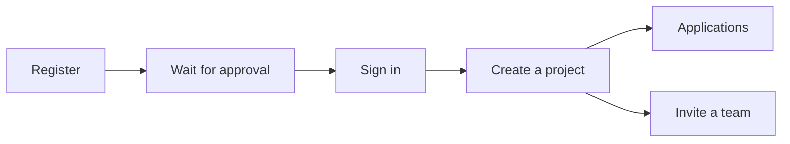

# User guide

How to use the SCS platform day to day. No deployment or server internals — those live in the [Technical documentation](../technical/index.md).

The pictures show the demo project **robert Demo** on the German interface. A demo project includes WissKI, JupyterHub, and WebProtégé with sample data. Each account can create exactly one.

## Guides

1. [Registration](registration.md) — request an account and wait for approval.
2. [Sign in](sign-in.md) — reach the project page with the SCS login.
3. [Create a project](create-project.md) — your own project or a demo project.
4. [Applications](applications.md) — WissKI, JupyterHub, WebProtégé, SQL database, and triplestore.
5. [Project members](members.md) — invite people, accept, remove.
6. [Project files](project-files.md) — the shared folder in Drive, JupyterHub, and WissKI.

## Available applications

- [JupyterHub with OpenRefine](apps/jupyter.md)
- [MariaDB with phpMyAdmin](apps/mariadb.md)
- [Nextcloud with OnlyOffice and draw.io](apps/nextcloud.md)
- [OpenGDB](apps/opengdb.md)
- [WebProtégé](apps/webprotege.md)
- [WissKI Environment](apps/wisski.md)

## Need help?

Contact your system administrator for access, sharing, or quota questions.
