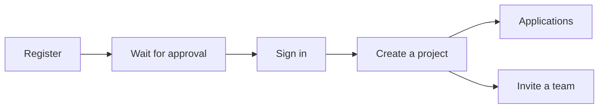

# User guide

How to use the SCS platform day to day. No deployment or server internals — those live in the [Technical documentation](../technical/index.md).

The pictures show the demo project **robert Demo** on the German interface. A demo project includes WissKI, JupyterHub, and WebProtégé with sample data. Each approved account gets exactly one, in addition to a project of their own.

## Guides

1. [Registration](registration.md) — request an account and wait for approval.
2. [Sign in](sign-in.md) — reach the project page with the SCS login.
3. [Create a project](create-project.md) — your own project. The demo project is already there.
4. [Applications](applications.md) — WissKI, JupyterHub, WebProtégé, SQL database, and triplestore.
5. [Project members](members.md) — invite people, accept, remove.
6. [Project files](project-files.md) — the shared folder in Drive, JupyterHub, and WissKI.

## Available applications

- [JupyterHub with OpenRefine](apps/jupyter.md)
- [MariaDB with phpMyAdmin](apps/mariadb.md)
- [Nextcloud with OnlyOffice and draw.io](apps/nextcloud.md)
- [OpenGDB](apps/opengdb.md)
- [WebProtégé](apps/webprotege.md)
- [WissKI Environment](apps/wisski.md)

## Messages

**Messages** in the menu lists project invitations and messages from the administration. A message from the administration opens as a conversation: your messages on the right, the administration's on the left, with the name of the person who wrote it. Reply in the field at the bottom. You can edit or delete your own messages; a deleted message shows "Message deleted". The number in the menu counts invitations and conversations with a new message.

## Need help?

Contact your system administrator for access, sharing, or quota questions.
