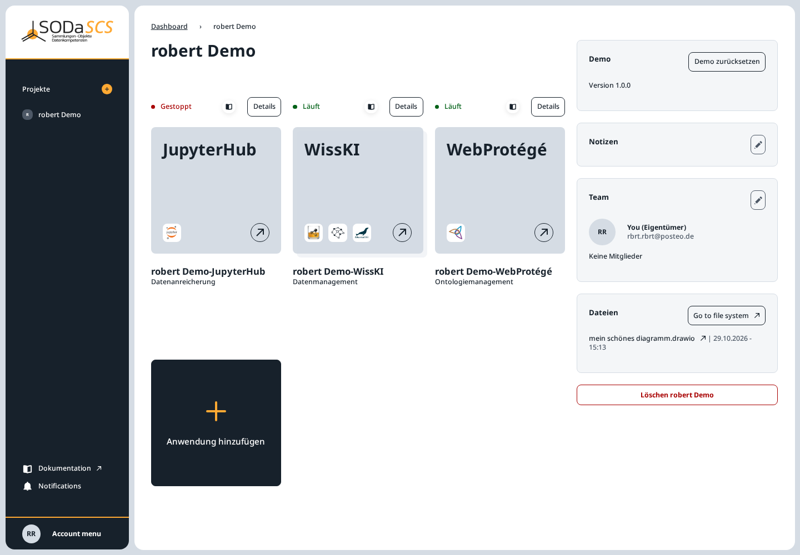
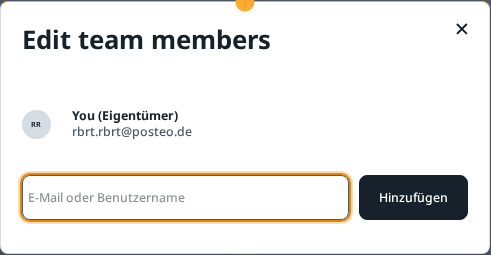

# Project members

The team is the owner and the people who have accepted an invitation. Only the owner invites people and removes members.

On the project page the team is on the right. In the demo project nobody is there except the owner:

## Invite someone

1. The pencil next to **Team** opens **Edit team members**.
2. Enter the **E-Mail oder Benutzername** of an existing SCS account.
3. **Hinzufügen**.

The person must already be registered and approved. You cannot invite yourself, someone who is already in the project, or someone who already has an open invitation.

The same question appears in the wizard before the project is created. The field there is **Username oder E-Mail**. In that case the invitation is sent only when you choose **Projekt anlegen**. See [Create a project](create-project.md).

## Accept or decline

The invited person receives an email and an entry under **Notifications** (the bell in the sidebar). The message has **Annehmen** and **Ablehnen**.

- **Annehmen** adds the person to the team. They see the project on their **Projekte** page and can reach the applications and the project folder.
- **Ablehnen** drops the invitation. The owner sees that status among the open invitations and can send the invitation again or delete it.

Open and declined invitations stay in the same window under the members until they are accepted.

## Remove a member

In **Edit team members**, every member except the owner has a cross. A click asks for confirmation; only the confirmation removes the person. They lose access to the applications and the project folder. The owner account stays.

If you are only a member, the same cross is on your own entry. The confirmation is then **Projekt verlassen**. The project stays for everyone else.

## Delete the project

The red **Löschen** button under the team removes the whole project. If other members are still in it, the dialog names them. You remove them first, or you choose in the dialog to remove them and delete the project. With no other members, the confirmation deletes the project immediately. Neither can be undone.
