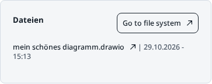
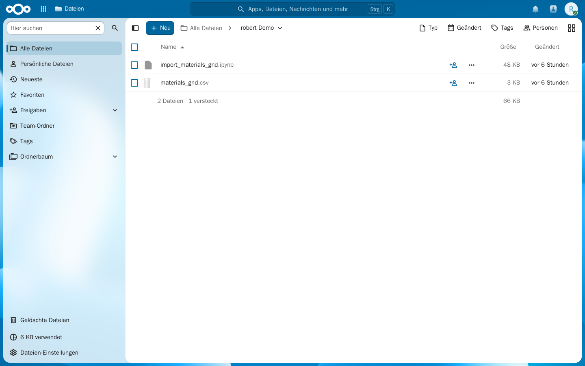
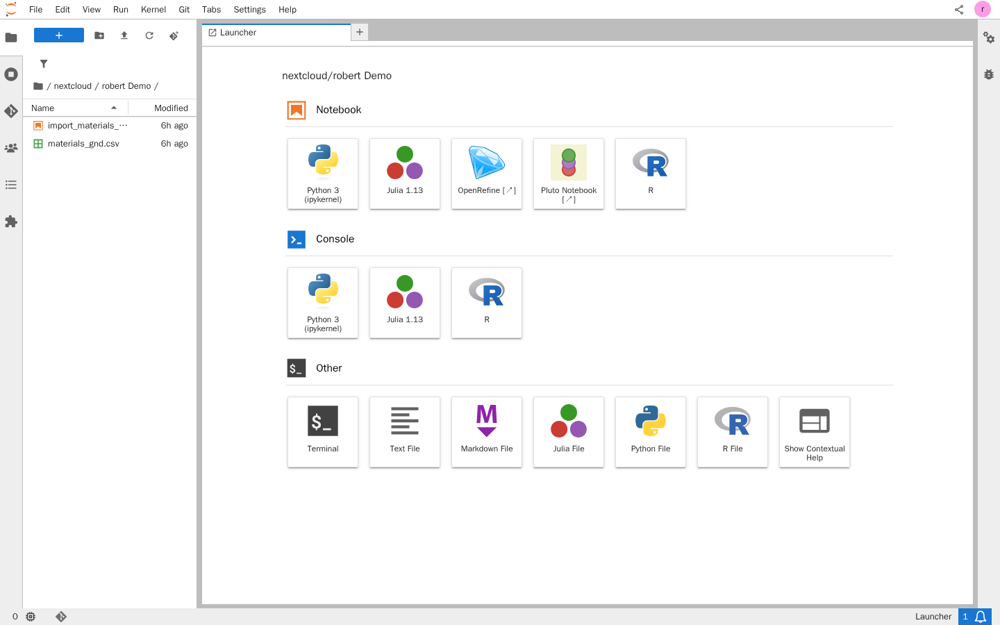
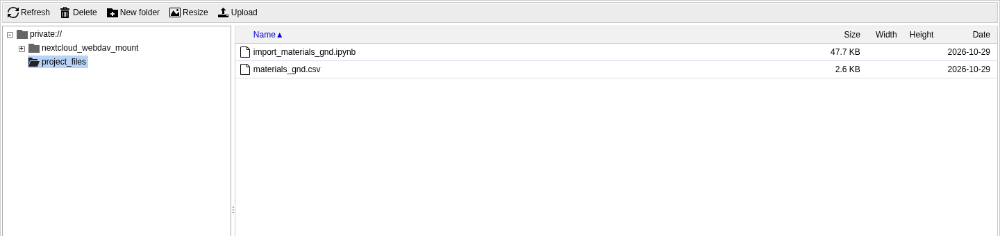

# Project files

Every project has one folder. It holds that project's files. The same folder is available in SCS Drive, in JupyterHub, and in WissKI. A file you add or change in one place is the same file in the others.

Personal files outside this folder stay private. Jupyter and WissKI do not see them.

## On the project page

On the right of the project page, **Dateien** lists the latest changes in the project folder. **Go to file system** opens the folder in SCS Drive.

If it asks you to connect your Drive account, choose **Connect Drive**. The list shows changes after that.

## In SCS Drive

The folder has the project's name. Every project member sees it in their drive and can upload, change, and delete files.

The **`SCS-Share`** folder is a different folder: it is for the whole platform, not for one project. Files that Jupyter or WissKI should use belong in the project folder.

## In JupyterHub

Open the lab from the project's **JupyterHub** card. In the file browser the project folder is under `nextcloud/<project name>`.

- All members share this lab and see each other's edits live.
- Other folders from your drive do not appear there.
- New members can open the folder right away, no restart needed.
- Changes made in the drive appear in the lab after about 30 seconds. If someone edits the same file in the drive and in the lab at once, the last save wins.
- In the drive's activity list, changes made from the lab appear as **SCS project mounts**.
- The lab starts on its own and stops after about an hour without use.

## In WissKI

WissKI mounts the same project folder. You can use files from it on records, for example as an image or an attachment. In the WissKI file system the folder is called `project_files`.

A file you put in the drive, or under `nextcloud/<project name>` in Jupyter, shows up in WissKI under `project_files`. The other direction works the same way.

Older WissKI instances still show that same folder as `nextcloud`.

## Resetting a demo

A demo reset overwrites the files in this folder with the sample data. What else a reset replaces is described in [Create a project](create-project.md).
