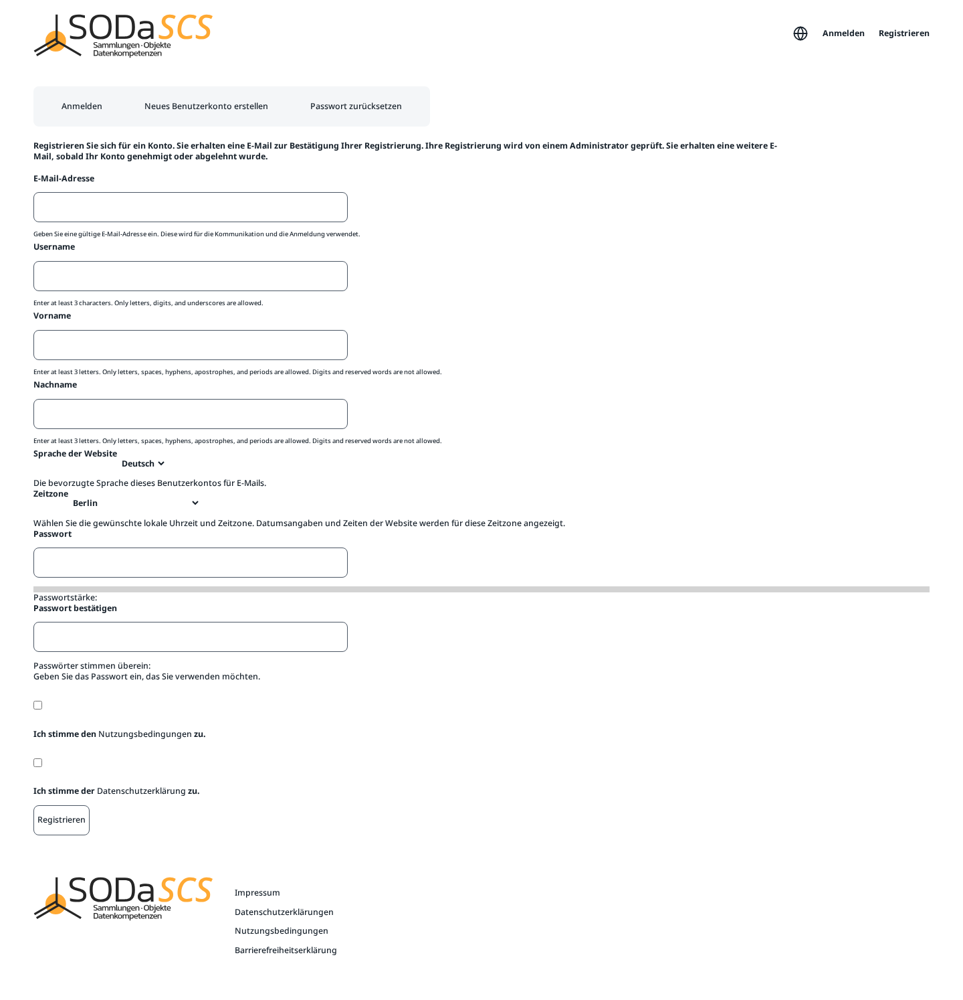

# Registration

You request an account yourself. You can use it only after it has been approved.

Open SCS Manager and choose **Registrieren** at the top. The same page is the tab **Neues Benutzerkonto erstellen** (create a new account).

## What you enter

| Field | Rule |
|---|---|
| **E-Mail-Adresse** | An address you can read. Registration mail goes there, and you can sign in with it later. |
| **Username** | At least 3 characters. Letters, digits, and underscores. |
| **Vorname** and **Nachname** | First and last name, at least 3 letters each. Letters, spaces, hyphens, apostrophes, and periods. No digits. |
| **Sprache der Website** | German or English. This is the language of the interface and of email. |
| **Zeitzone** | Your local time, usually **Berlin**. Times on the platform use this zone. |
| **Passwort** and **Passwort bestätigen** | The same password twice. A strength meter appears underneath. |

Check **Ich stimme den Nutzungsbedingungen zu** (terms of service) and **Ich stimme der Datenschutzerklärung zu** (privacy policy). Both texts open from the link in the sentence. Then **Registrieren**.

!!! note "Approval"
    **Registrieren** does not create the account yet. You receive an email that the registration arrived. An administrator reviews it. A second email tells you whether the account was approved or rejected. You can sign in only after approval.

You cannot register the same email address or the same username again while a request is open or the account already exists.
