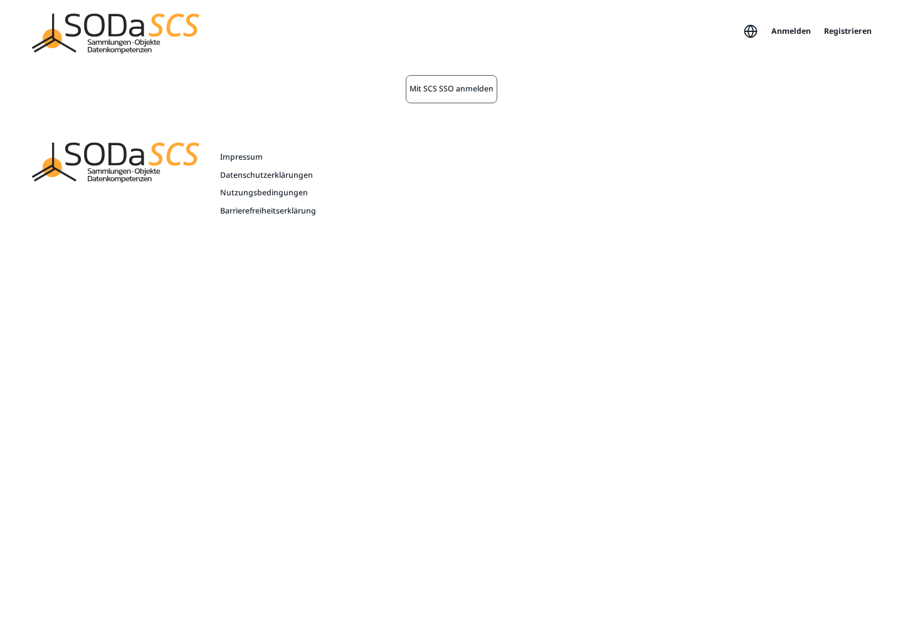
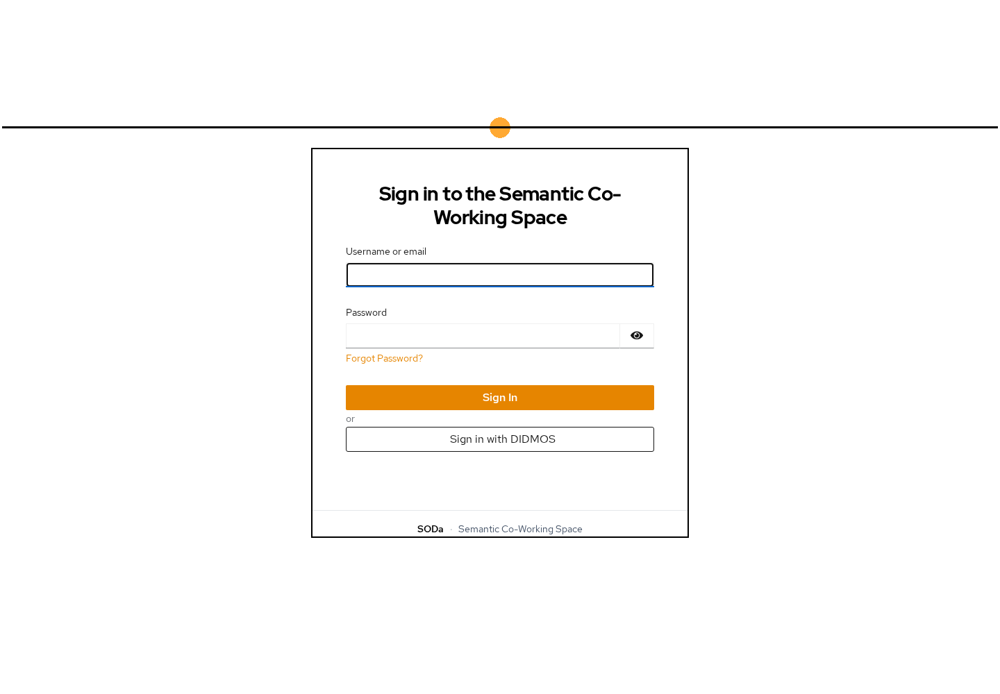

# Sign in

After approval you sign in with the username or email address and the password from registration.

1. Open SCS Manager and choose **Anmelden**.
2. On the next page choose **Mit SCS SSO anmelden**.

3. The Semantic Co-Working Space sign-in opens. Enter **Username or email** and **Password**, then **Sign In**.

**Forgot Password?** resets the password when you know the account email.

Use **Sign in with DIDMOS** when your institution offers sign-in through DIDMOS. Otherwise the username and password from registration are the way in.

## After that

You land on **Projekte**. There you see your project cards, the search field, and **Projekt anlegen**.

On the very first sign-in an introduction may cover the platform. **Einführung überspringen** closes it. Otherwise it walks through the idea of the platform and offers to create the first project or a demo project immediately. The connection to file storage runs in the background. Only if that fails does a step **Nextcloud verbinden** ask you to sign in to Drive once more. Pop-ups must be allowed for that.

The introduction appears only once. The pictures in the next chapters show the interface after that, on the demo project **robert Demo**.

Forgotten password, or an account that is not approved yet: **Anmelden** does not take you to the project page. Wait for the approval email, or reset the password with **Forgot Password?**. **Passwort zurücksetzen** on the registration page is the same path.
